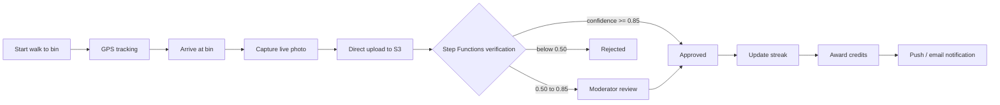
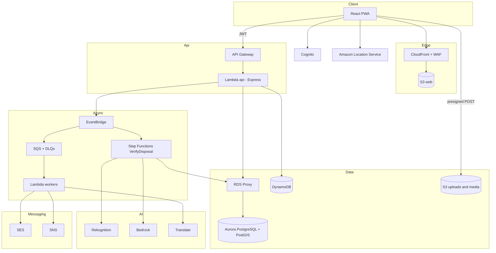

# CleanStreak on AWS

> Make proper waste disposal a daily habit. Snap a photo of yourself using the dustbin, grow your streak, earn credits, and unlock rewards.

This is an **AWS-native re-implementation** of [shazebkh/AWS-miniproject](https://github.com/shazebkh/AWS-miniproject) (CleanStreak). Every runtime service (frontend hosting, API, database, queues, storage, AI verification, identity, email, maps, CI/CD, monitoring) is an AWS service.

The detailed engineering plan, phase breakdown, schemas, state machine and IAM samples are in [`implementation.md`](./implementation.md).

*CleanStreak is a working name. Rename it freely.*

---

## Table of Contents

1. [Overview](#overview)
2. [Features](#features)
3. [How It Works](#how-it-works)
4. [Streaks, Credits and Rewards](#streaks-credits-and-rewards)
5. [Calorie Estimator](#calorie-estimator)
6. [Reporting Poor Waste Management](#reporting-poor-waste-management)
7. [AWS Services Used](#aws-services-used)
8. [What Replaced What](#what-replaced-what)
9. [Architecture](#architecture)
10. [Project Structure](#project-structure)
11. [Getting Started](#getting-started)
12. [Configuration](#configuration)
13. [API Overview](#api-overview)
14. [Environments and Deployment](#environments-and-deployment)
15. [Observability](#observability)
16. [Security and Privacy](#security-and-privacy)
17. [Cost Notes](#cost-notes)
18. [Roadmap](#roadmap)
19. [Contributing](#contributing)
20. [License](#license)

---

## Overview

Littering is rarely about a lack of bins. It is about habit. CleanStreak borrows the mechanics that make people return to language and fitness apps (streaks, points, rewards) and applies them to responsible waste disposal.

**The loop**

1. You throw garbage in a dustbin and take a photo as proof.
2. The app verifies the photo and adds it to your timeline.
3. Consecutive days build a **streak**, and streaks earn **credits**.
4. Credits unlock **rewards**.
5. Along the way the app shows the **calories you burned** walking to the bin, lets you **report** areas with poor waste management to the authorities, and teaches you **how to manage waste** better.

## Features

| Feature | Description |
|---|---|
| Photo proof | Live photo of you disposing of waste, geotagged and timestamped |
| Timeline | Calendar and feed of verified disposals |
| Streaks | Consecutive days grow your streak, freezes protect busy days |
| Credits | Verified disposals earn credits, with milestone bonuses |
| Rewards | Redeem credits by tier (Bronze, Silver, Gold, Platinum) |
| Calorie estimator | Walk distance, time, speed to estimated kcal |
| Report to authorities | Geotagged photo reports, duplicates merged, status tracking |
| Waste tips | Daily tip plus searchable library, personalised and localised |
| Nearby bins | Map of dustbins around you |
| Leaderboards | Optional, opt-in neighbourhood and city boards |

## How It Works



Verification combines duplicate-photo detection (perceptual hash), EXIF and GPS plausibility, **Amazon Rekognition** labels, rule-based features, a user trust score, and, only for borderline photos, an optional **Amazon Bedrock** multimodal check. A moderator queue handles the middle band.

## Streaks, Credits and Rewards

These are the default values. They live in an **AWS AppConfig** profile, so you can tune them without redeploying code.

**Earning credits**

| Action | Credits |
|---|---|
| First verified disposal of the day | 10 (multiplied by the streak multiplier) |
| Extra disposals (up to 2 more per day) | 2 each |
| Accepted waste report | 15 |
| Completing the daily tip quiz | 3 |

**Streak milestones**

| Streak | Bonus credits |
|---|---|
| 3 days | +5 |
| 7 days | +20 |
| 14 days | +40 |
| 30 days | +100 |
| 60 days | +250 |
| 100 days | +500 |

**Streak multiplier:** +10% for every 7 consecutive days, capped at 2x.

**Streak freeze:** Earn one freeze every 10 days (max 2 held). A freeze automatically covers one missed day.

**Reward tiers**

| Tier | Lifetime credits | Example rewards |
|---|---|---|
| Bronze | 0 | Badges, profile frames |
| Silver | 500 | Partner coupons, reusable bag |
| Gold | 1,500 | Eco-products, plant a tree in your name |
| Platinum | 4,000 | Premium partner rewards, community recognition |

Credits are stored in an **append-only ledger** in Aurora. The application database role has no `UPDATE` or `DELETE` permission on it, and each entry carries a unique idempotency key, so a replayed event can never award credits twice.

## Calorie Estimator

```
calories (kcal) = MET x weight (kg) x duration (hours)
```

MET depends on walking speed (about 3.5 at 4.8 km/h and 4.3 at 5.6 km/h). Weight is optional. A default is used otherwise and the result is labelled as an estimate. The value is in the **cumulative** weekly and monthly total, not any single short walk.

## Reporting Poor Waste Management

Users can report overflowing or damaged bins, illegal dumping, open burning, missing bins, and lack of segregation. Each report has photos, an auto-captured location (reverse-geocoded with **Amazon Location Service**), a category and an optional description. Nearby duplicate reports are merged with PostGIS `ST_DWithin`.

Reports are forwarded through a pluggable adapter:

| Adapter | AWS service | Use |
|---|---|---|
| `simulated` | Aurora + CloudWatch | Default outside production. Writes a test mailbox and audit log |
| `ses` | Amazon SES | Email to the authority |
| `webhook` | EventBridge API Destinations | Portals and webhooks, with auth, retries and rate limits |

A safety switch (`ADAPTER_MODE`) allows `live` only in `prod`, and the SES sandbox blocks unverified recipients everywhere else.

---

## AWS Services Used

| Layer | Services |
|---|---|
| **Frontend** | Amazon S3, Amazon CloudFront, Amazon Route 53, AWS Certificate Manager, AWS WAF, Amazon Location Service (maps), Amazon CloudWatch RUM (optional) |
| **API and compute** | Amazon API Gateway (HTTP API), AWS Lambda (Node.js on arm64) |
| **Identity** | Amazon Cognito (email OTP, optional Google federation, groups) |
| **Database** | Amazon Aurora PostgreSQL Serverless v2 with PostGIS, Amazon RDS Proxy, Amazon DynamoDB |
| **Cache** (optional) | Amazon ElastiCache Serverless (Valkey) |
| **Storage** | Amazon S3 (raw uploads, public media), AWS KMS |
| **Async and workflow** | Amazon EventBridge (bus, Scheduler, API Destinations), Amazon SQS, Amazon SNS, AWS Step Functions |
| **AI** | Amazon Rekognition, Amazon Bedrock, Amazon Translate, Amazon SageMaker AI (optional custom model) |
| **Messaging** | Amazon SES, AWS End User Messaging (SMS, future mobile push) |
| **Config and secrets** | AWS AppConfig, AWS Systems Manager Parameter Store, AWS Secrets Manager |
| **Security** | AWS IAM, AWS WAF, AWS Shield Standard, AWS CloudTrail, Amazon GuardDuty |
| **DevOps** | AWS CDK, AWS CloudFormation, AWS CodeConnections, AWS CodePipeline, AWS CodeBuild, AWS Backup, Amazon ECR (optional) |
| **Observability and cost** | Amazon CloudWatch (Logs, Metrics, Alarms, Dashboards, Synthetics), AWS X-Ray, AWS Budgets, Cost Anomaly Detection |

Deliberately **not** used: Amazon Pinpoint (support ended 30 Oct 2026) and AWS App Runner (closed to new customers since 30 Apr 2026).

## What Replaced What

| Original (source repo) | AWS in this project |
|---|---|
| Next.js PWA (README) / Vite + React 19 served by Express (code) | React 19 + Vite SPA on S3 + CloudFront |
| NestJS (README) / Express router on port 3000 (code) | Same Express app on Lambda behind API Gateway |
| PostgreSQL + PostGIS / in-memory store | Aurora PostgreSQL Serverless v2 + PostGIS + RDS Proxy |
| Redis | Aurora materialized views, optional ElastiCache (Valkey) |
| BullMQ queues and cron | SQS, EventBridge, EventBridge Scheduler, Step Functions |
| S3-compatible storage / MinIO | Amazon S3 with presigned POST uploads |
| Photos as base64 in JSON | Direct browser-to-S3 upload |
| FastAPI + YOLO verification | Rekognition + ported rule engine + optional Bedrock (SageMaker optional) |
| Google Gemini SDK (`@google/genai`) | Amazon Bedrock Converse API |
| Hand-rolled JWT, refresh, OTP, Google sign-in | Amazon Cognito |
| SMTP | Amazon SES |
| Web Push / FCM | Lambda `web-push` (VAPID) fed by SQS |
| OpenStreetMap tiles | Amazon Location Service via MapLibre |
| `.env` files | Secrets Manager, Parameter Store, AppConfig |
| Docker Compose | AWS CDK (Compose kept for local development only) |
| GitHub Actions | CodePipeline + CodeBuild (source still in GitHub) |
| `console.log` | CloudWatch Logs + X-Ray + Powertools for AWS Lambda |

Two documented exceptions to "everything is AWS": browser Web Push is relayed by each browser vendor's push service (an inherent part of the standard, and AWS has no managed Web Push service), and Google sign-in, if you enable it, is an optional federated identity provider.

---

## Architecture



---

## Project Structure

The layout stays close to the source repository so the diff is easy to follow.

```
cleanstreak/
├── src/                          # React 19 + Vite frontend (PWA)
├── apps/
│   └── api/
│       └── src/
│           ├── app.ts            # createApp() - Express app, no listen()
│           ├── routes/api.ts     # existing router, unchanged contract
│           ├── handlers/         # Lambda entrypoints: api.ts, workers/*, verification/*
│           ├── ports/            # repository interfaces
│           ├── adapters/
│           │   ├── db/{memory,aurora}/
│           │   ├── storage/s3.ts
│           │   ├── ai/{rekognition,bedrock}.ts
│           │   ├── mail/{simulated,ses,webhook}.ts
│           │   └── push/webpush.ts
│           └── modules/          # auth, walks, disposals, streaks, credits, rewards,
│                                 # reports, tips, bins, notifications, admin
├── packages/
│   └── shared/                   # credit rules defaults, types, calorie/MET function
├── db/
│   └── migrations/               # SQL migrations (PostGIS)
├── infra/
│   ├── bin/ lib/ config/         # AWS CDK app (TypeScript)
│   └── local/docker-compose.yml  # laptop-only PostGIS + LocalStack
├── server.ts                     # local dev server (Express + Vite), not deployed
├── docs/adr/                     # architecture decision records
├── README.md
└── implementation.md
```

---

## Getting Started

**Prerequisites:** AWS account and credentials (IAM Identity Center recommended), AWS CLI v2, Node.js 22+, pnpm, Docker (local development only).

### 1. Clone and install

```bash
git clone https://github.com/<your-username>/cleanstreak-aws.git
cd cleanstreak-aws
pnpm install
```

### 2. Run locally (no AWS account needed)

```bash
docker compose -f infra/local/docker-compose.yml up -d   # PostGIS + LocalStack
cp .env.example .env.local
pnpm --filter api db:migrate
pnpm --filter api db:seed        # tips, rewards, sample bins
pnpm dev                          # http://localhost:3000
```

Local mode uses the `memory` or local-Postgres database adapter and the `simulated` mail adapter, and skips Rekognition and Bedrock (rules-only verification).

### 3. Prepare AWS (one time per account and Region)

```bash
export AWS_PROFILE=cleanstreak-dev
export AWS_REGION=ap-south-1
pnpm --filter infra cdk bootstrap
```

Before the first deploy, in the AWS console:

- Request **Amazon Bedrock model access** for the model you will use (only if enabling the Bedrock check).
- Request **Amazon SES production access** (new accounts start in the sandbox).
- If you want Google sign-in, create an OAuth client and store its secret in Secrets Manager as `cleanstreak/<env>/google-oauth`.

### 4. Deploy

```bash
pnpm deploy:dev              # cdk deploy --all -c env=dev
```

The deploy prints the web URL, API URL, Cognito IDs, and Location map settings. The `migrator` Lambda runs automatically after the database is ready. Seed data:

```bash
pnpm --filter infra seed -c env=dev
```

### 5. Create an admin / moderator

```bash
aws cognito-idp admin-add-user-to-group \
  --user-pool-id <UserPoolId> --username <email> --group-name moderators
```

### 6. Tear down a dev stack

```bash
pnpm --filter infra cdk destroy --all -c env=dev
```

`prod` has deletion protection and retained data stores, so destroy is intentionally blocked there.

---

## Configuration

No static AWS keys exist anywhere. Lambdas use execution roles.

| Setting | Where it lives |
|---|---|
| Database endpoint, user (IAM auth) | CDK-injected Lambda environment (`DB_PROXY_ENDPOINT`, `DB_NAME`, `DB_USER`) |
| Verification thresholds (default `0.85` / `0.50`), weights, flags | AppConfig profile `verification` |
| Credit, streak, tier and calorie rules | AppConfig profile `credit_rules` |
| Authority fallback email | Parameter Store `/cleanstreak/<env>/authority/default-email` |
| VAPID public key / private key | Parameter Store / Secrets Manager |
| Mail sender and configuration set | `SES_FROM_ADDRESS`, `SES_CONFIGURATION_SET` |
| Bedrock model | `BEDROCK_MODEL_ID` (model or inference profile available in your Region) |
| Adapter safety switch | `ADAPTER_MODE=simulated|live` (`live` only in `prod`) |

Frontend build-time variables (public by design, never put secrets here):

```
VITE_API_BASE_URL
VITE_COGNITO_USER_POOL_ID
VITE_COGNITO_CLIENT_ID
VITE_COGNITO_DOMAIN
VITE_LOCATION_REGION
VITE_LOCATION_API_KEY        # restricted by referrer and map-read actions only
VITE_MAP_STYLE
VITE_VAPID_PUBLIC_KEY
```

Camera access requires HTTPS. CloudFront provides it, so no tunnel is needed on a phone. For local phone testing, use an HTTPS tunnel.

---

## API Overview

Paths match the source repository. Full details are in [`implementation.md`](./implementation.md#6-api-contract-and-routing).

| Method | Endpoint | Purpose |
|---|---|---|
| POST | `/auth/register`, `/auth/login`, `/auth/refresh` | Account management (Cognito facade) |
| POST | `/uploads/presign` | Get a presigned S3 POST for a photo (new) |
| POST | `/walks/start`, `/walks/:id/points`, `/walks/:id/finish` | Track the walk to the bin |
| POST | `/disposals` | Submit a disposal (returns `202`, verification is asynchronous) |
| GET | `/me/streak` | Current and longest streak |
| GET | `/me/credits` | Balance and ledger |
| GET / POST | `/rewards`, `/rewards/:id/redeem` | Browse and redeem rewards |
| POST / GET | `/reports`, `/reports/:id` | Submit and track waste reports |
| GET | `/tips/daily`, `/tips` | Waste management tips (`?lang=`) |
| GET | `/bins/nearby` | Nearby dustbins |
| POST | `/me/push-subscriptions` | Register a browser for push (new) |
| GET / POST | `/admin/*` | Review queue, audit log, mailbox (Cognito groups) |
| GET | `/health` | Liveness |

**One intentional contract change:** `POST /disposals` returns `202 Accepted` instead of a synchronous result, because verification runs in a Step Functions workflow. The app polls `GET /me/disposals/:id` or reacts to the push notification.

---

## Environments and Deployment

| Environment | Account | Notes |
|---|---|---|
| `dev-<name>` | shared dev | Ephemeral per-developer stacks. Single AZ, Bedrock off, no WAF |
| `staging` | staging | Release candidate, e2e and load tests |
| `prod` | production | Multi-AZ, WAF on, deletion protection, manual approval |

CI/CD: GitHub, then AWS CodeConnections, then CodePipeline. Build and test run in CodeBuild (lint, typecheck, unit, adapter contract tests, bundle, `cdk synth`). Staging deploys automatically, prod after manual approval, with Lambda canary deployments and automatic rollback on CloudWatch alarms.

---

## Observability

- Structured JSON logs with correlation ids (Powertools for AWS Lambda), X-Ray tracing across API Gateway, Lambda and Step Functions.
- Business metrics: disposals submitted, verification outcome mix, review queue depth, credits awarded, reports dispatched, Bedrock calls and fallbacks.
- Alarms to an SNS ops topic: any DLQ message, API 5xx, p95 latency, failed state-machine executions, oldest review item age, Aurora capacity, Lambda throttles, budget thresholds.
- CloudWatch Synthetics canary for `/health`.

---

## Security and Privacy

- Least-privilege IAM per function, KMS encryption at rest, TLS everywhere, Aurora in isolated subnets reachable only through RDS Proxy.
- AWS WAF managed rules plus rate limits on `/auth/*` and `/disposals`.
- Uploads use presigned POST with size and type conditions. The key must live under the caller's own prefix.
- Location is collected only during a walk or when a photo or report is submitted. Walk GPS points expire after 30 days.
- Public images are EXIF-stripped and face-blurred derivatives. Raw originals stay private with a short retention period.
- Body measurements are optional and used only for calorie estimates.
- Users can export or delete their data. A Step Functions workflow removes S3 objects, walk points, push subscriptions and the Cognito user, and anonymises the ledger.
- Review compliance with applicable data protection laws (for example GDPR or India's DPDP Act) before launch.
- Users are reminded never to enter unsafe areas to take a photo or file a report.

---

## Cost Notes

Costs depend on Region and usage, so use the AWS Pricing Calculator with your own traffic numbers. The biggest levers:

- Call Bedrock only for borderline photos, behind a flag.
- Keep functions that do not touch the database outside the VPC, which avoids a NAT gateway and many interface endpoints.
- Skip ElastiCache until measurements justify it.
- Use lifecycle rules on raw uploads.
- Use the small `dev` profile for non-production stacks.
- Turn on AWS Budgets and Cost Anomaly Detection on day one.

---

## Roadmap

- [ ] **Phase 0 to 2:** accounts, spec reconciliation, data layer on Aurora, Cognito auth
- [ ] **Phase 3 to 4:** direct-to-S3 uploads, API on Lambda (walking skeleton)
- [ ] **Phase 5 to 6:** verification workflow, streaks, credits, rewards
- [ ] **Phase 7 to 9:** walks and maps, reports and adapters, tips and notifications
- [ ] **Phase 10 to 12:** frontend hosting, hardening and load test, launch readiness
- [ ] **Later:** native apps (SNS mobile push), SageMaker custom detector, Location Service geofences for arrival detection, municipality dashboard, partner API, community clean-up events

Detailed tasks and acceptance criteria per phase are in [`implementation.md`](./implementation.md#8-phased-delivery-plan).

---

## Contributing

1. Fork the repo and create a branch: `git checkout -b feature/your-feature`
2. Make your changes with tests (adapter changes must pass the shared contract suite)
3. Run `pnpm lint && pnpm test`
4. Open a pull request describing what and why

## License

MIT, same as the source project. See `LICENSE` for details.

## Attribution

Product concept, feature set and business rules come from [shazebkh/AWS-miniproject](https://github.com/shazebkh/AWS-miniproject). This repository re-implements it on AWS services.
