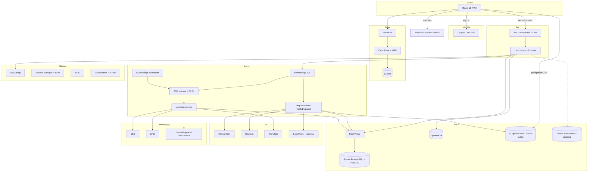
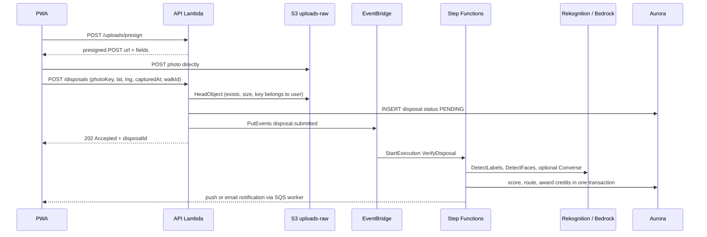

# CleanStreak on AWS: Implementation Plan

| | |
|---|---|
| **Source analysed** | https://github.com/shazebkh/AWS-miniproject (product name: *CleanStreak*) |
| **Goal** | Re-create the whole product so that every runtime service (frontend, backend, data, AI, messaging, identity, CI/CD, operations) is an AWS service |
| **Default Region** | `ap-south-1` (the source README cites India's DPDP Act; change if your users are elsewhere) |
| **Document date** | 24 Nov 2026 |
| **Status** | v1.0, ready for Phase 0 spec reconciliation |

---

## 0. Analysis scope and assumptions (read this first)

**Files I was able to read:** `README.md`, `DECISIONS.md`, `package.json`, `server.ts`, and the repository root listing.

**Files I could not read:** `implementation.md` (the repo's own spec with schemas and request/response bodies), `.env.example`, `PROGRESS.md`, `BLOCKERS.md`, `LOOP_LOG.md`, `vite.config.ts`, and the source folders `apps/api/src`, `src`, `packages/shared/src`, `infra`. GitHub rate-limited my fetches and blocks automated directory listing.

**Consequences**

- Architecture, feature set, business rules, endpoint list, and dependencies below are **grounded in what I read**.
- Table/column names, exact payloads, the weights of the existing rule-based verifier, and *where* `@google/genai` is called are **inferred**. Anything marked `[verify]` must be reconciled against the repo's `implementation.md` in **Phase 0, task 0.2**.
- The plan is deliberately structured so that reconciliation changes details, not architecture.

---

## 1. What the repository actually is

### 1.1 Product

CleanStreak turns responsible waste disposal into a daily habit: capture a geotagged photo while using a bin, verify it, grow a streak, earn credits, redeem rewards. Extras: calorie estimate for the walk to the bin, geotagged reports of poor waste management forwarded to a municipal authority, a tips library, nearby bins map, and opt-in leaderboards.

### 1.2 README versus what the code really does

This matters because the migration starts from the **code**, not the README.

| Aspect | README says | Code / DECISIONS.md shows | Implication for the AWS build |
|---|---|---|---|
| Frontend | Next.js PWA | Vite 8 + React 19 + Tailwind 4 + Leaflet + Motion, served by Express in dev (`server.ts`) | Pure static SPA. No SSR needed, so S3 + CloudFront is sufficient |
| Backend | NestJS | Express 4 `apiRouter`, mounted at `/api` **and** at `/` | Lift the Express router into Lambda. There is no NestJS code to port |
| Database | PostgreSQL + PostGIS | In-memory transactional store emulating `ST_DWithin`, Haversine, rollback (Decision 1) | The real persistence layer does not exist yet. It must be written behind repository interfaces |
| Cache / queues | Redis + BullMQ | Neither is in `package.json` | Async processing must be designed fresh: SQS, EventBridge, Step Functions |
| Storage | S3-compatible (MinIO locally) | Photos sent as base64/data-URL inside JSON, body limit 10 MB | Breaks on Lambda (6 MB sync payload). Replace with direct-to-S3 upload |
| Verification | Python FastAPI + YOLO | Rule-based TypeScript detector: image entropy, luminance, bin/hand features, EXIF capture recency, GPS plausibility, trust score, plus a moderator queue | Port the rules to Lambda, add Rekognition and Bedrock signals |
| AI SDK | none mentioned | `@google/genai` is a runtime dependency | Non-AWS dependency. Replace with Bedrock `[verify usage]` |
| Perceptual hash | not specified | Pure-TS 64-bit dHash/pHash, duplicate if Hamming distance <= 6 (Decision 2) | Lambda-friendly (no native build). Keep as is |
| Email | SMTP | `EmailAdapter` writes to a simulated authority mailbox and an audit log shown in Admin (Decision 4) | Keep the adapter pattern, add an SES adapter and a safety switch |
| Package manager | pnpm | `bun.lock` present, scripts run via `tsx` | Pick one. This plan uses pnpm |
| Tests | not described | vitest: `test:unit`, `test:integration`, `test:e2e`, supertest | Keep the suite, add adapter contract tests |
| Infra | docker-compose (Postgres, Redis, MinIO) | `infra/` exists, Docker unavailable in the AI Studio sandbox | Replace with CDK for cloud. Compose is local-dev only |
| Repo hygiene | n/a | `PROGRESS.md`, `BLOCKERS.md`, `LOOP_LOG.md` look like agent working notes | Do not carry over. Convert `DECISIONS.md` into ADRs |

### 1.3 Functional modules to reproduce

`auth`, `walks`, `disposals`, `streaks`, `credits`, `rewards`, `reports`, `tips`, `bins`, `notifications`, `admin` (review queue, audit log, simulated mailbox).

### 1.4 Business rules that must survive the migration unchanged

| Rule | Value (from README/DECISIONS) |
|---|---|
| Credits | First verified disposal/day: 10 x streak multiplier. Extra disposals: 2 each, max 2 more/day. Accepted report: 15. Daily tip quiz: 3 |
| Streak milestones | 3d +5, 7d +20, 14d +40, 30d +100, 60d +250, 100d +500 |
| Streak multiplier | +10% per 7 consecutive days, cap 2x |
| Streak freeze | Earn 1 per 10 days, hold max 2, auto-covers one missed day |
| Tiers | Bronze 0, Silver 500, Gold 1,500, Platinum 4,000 lifetime credits |
| Verification routing | confidence >= 0.85 approve; 0.50 to <0.85 manual review; < 0.50 reject |
| Duplicate photo | 64-bit pHash, Hamming distance <= 6 |
| Ledger | Append-only. Balances never edited directly |
| Calories | `kcal = MET x weight_kg x hours`, MET ~3.5 @ 4.8 km/h, ~4.3 @ 5.6 km/h, default weight if unset, labelled as estimate |
| Privacy | EXIF stripped and faces blurred on public images, location only on walk/photo/report, export and delete on request |
| Safety | Never send real email to live municipal contacts (adapter safety switch) |

### 1.5 Non-AWS components found (the "replace list")

Express + Vite dev server, self-hosted PostgreSQL/PostGIS, Redis, BullMQ, MinIO / S3-compatible endpoint, FastAPI + YOLO service, Google Gemini SDK, hand-rolled JWT/refresh/OTP, SMTP, Web Push/FCM, OpenStreetMap tiles via Leaflet, `.env` secrets, Docker Compose, GitHub Actions.

---

## 2. Service replacement matrix

Legend for **Phase**: P1 = MVP path, P2 = after MVP, Opt = optional.

### 2.1 Frontend

| # | Original | AWS replacement | Phase | Notes |
|---|---|---|---|---|
| F1 | Vite dev server / Express static serving | **Amazon S3** (private bucket) + **Amazon CloudFront** (Origin Access Control) | P1 | SPA fallback via CloudFront custom error response (403/404 to `/index.html`). Hashed assets cached 1 year, `index.html` no-cache |
| F2 | Domain / TLS | **Amazon Route 53** + **AWS Certificate Manager** (cert in `us-east-1` for CloudFront) | P1 | Separate `app.` and `api.` hostnames |
| F3 | Edge protection | **AWS WAF** on CloudFront and API Gateway, **AWS Shield Standard** (automatic) | P1 | Managed rule groups + rate-based rule on `/auth/*` |
| F4 | Leaflet + OpenStreetMap tiles | **Amazon Location Service** (Maps) rendered with MapLibre | P1 | Keep Leaflet via `@maplibre/maplibre-gl-leaflet` for a minimal UI diff, or migrate to MapLibre GL JS. API key restricted by referrer |
| F5 | Reverse geocoding (address on reports) | **Amazon Location Service** (Places) | P2 | `ReverseGeocode` when a report is created |
| F6 | Login UI (own forms + JWT) | **Amazon Cognito** managed login, or `aws-amplify` Auth library | P1 | See 5.3 |
| F7 | Web Push in the PWA | Browser Push API, backend delivery on **AWS Lambda** | P2 | See 5.10. No managed AWS Web Push service exists |
| F8 | Frontend monitoring | **Amazon CloudWatch RUM** | Opt | Web vitals, JS errors |
| F9 | Alternative hosting | **AWS Amplify Hosting** | Opt | Acceptable if you prefer git-driven previews. CDK path below uses S3 + CloudFront |
| F10 | Camera, geolocation, step/GPS tracking | Browser APIs (unchanged) | P1 | HTTPS is provided by CloudFront, so camera works on phones without a tunnel |

### 2.2 Backend compute and API

| # | Original | AWS replacement | Phase | Notes |
|---|---|---|---|---|
| B1 | `server.ts` Express on port 3000 | **Amazon API Gateway (HTTP API)** + **AWS Lambda** running the *same* Express app via a serverless adapter | P1 | Split `createApp()` from `listen()`. Vite middleware must not be imported in the Lambda bundle |
| B2 | NestJS (README only) | Not applicable | | Not present in code |
| B3 | Route mounting at `/api` and `/` | API Gateway `$default` catch-all route plus explicit unauthenticated routes | P1 | Express keeps both mounts, so the frontend contract is untouched |
| B4 | JSON body limit 10 MB (photos) | Direct browser-to-S3 upload with **presigned POST** | P1 | Mandatory, see trap T1 |
| B5 | Rate limiting (none seen) | API Gateway throttling + AWS WAF rate rules | P1 | |
| B6 | Alternative to Lambda | **Amazon ECS on AWS Fargate** + **Application Load Balancer** | Opt | Fits if cold starts or the 15-min limit become a problem. Not **AWS App Runner** (moved to maintenance for new customers on 30 Apr 2026) |

### 2.3 Data

| # | Original | AWS replacement | Phase | Notes |
|---|---|---|---|---|
| D1 | In-memory store (code) / PostgreSQL + PostGIS (README) | **Amazon Aurora PostgreSQL (Serverless v2)** with PostGIS | P1 | Real transactions, `ST_DWithin`, GiST indexes |
| D2 | DB connections | **Amazon RDS Proxy** (IAM auth) | P1 | Protects Aurora from Lambda connection storms |
| D3 | Walk GPS points (`/walks/:id/points`) | **Amazon DynamoDB** (TTL 30 days) + summary row in Aurora at finish | P1 | High-rate append-only writes, short-lived |
| D4 | Idempotency for `POST /disposals`, `/redeem` | **DynamoDB** via Powertools for AWS Lambda idempotency | P1 | Plus a UNIQUE `idempotency_key` in the ledger |
| D5 | Redis cache / leaderboards / rate counters | **Amazon ElastiCache Serverless (Valkey)** | Opt | MVP can use an Aurora materialized view. Add Valkey only when read load justifies it |
| D6 | S3-compatible storage / MinIO | **Amazon S3** (3 buckets, SSE-KMS) | P1 | `uploads-raw`, `media-public`, `web` |
| D7 | Backups | **AWS Backup** + Aurora PITR + S3 versioning | P1 | |

### 2.4 Asynchronous work and AI

| # | Original | AWS replacement | Phase | Notes |
|---|---|---|---|---|
| A1 | BullMQ job queues | **Amazon SQS** (standard queues + DLQs) | P1 | Notifications, report dispatch, translation |
| A2 | BullMQ repeatable jobs / cron | **Amazon EventBridge Scheduler** | P2 | Daily tip, "streak at risk", status sync |
| A3 | Domain events | **Amazon EventBridge** custom bus | P1 | `disposal.submitted`, `disposal.approved`, `report.status_changed` |
| A4 | Verification pipeline + moderator wait | **AWS Step Functions** (Standard) with `waitForTaskToken` for manual review | P1 | See 5.6 |
| A5 | FastAPI + YOLO detector | **Amazon Rekognition** `DetectLabels` / `DetectFaces` | P1 | Primary object/person signal |
| A6 | Existing rule-based detector (entropy, luminance, EXIF, GPS, trust) | Same logic ported to Lambda (TypeScript) | P1 | Score combines rules + Rekognition + optional Bedrock |
| A7 | `@google/genai` (Gemini) | **Amazon Bedrock** (Converse API, multimodal model) | P1/P2 | Used only for medium-confidence photos and tip personalisation |
| A8 | Custom YOLO model (if you must keep it) | **Amazon SageMaker AI** real-time or serverless endpoint, image in **Amazon ECR** | Opt | Rekognition Custom Labels has narrow Region availability, so verify before relying on it |
| A9 | Moderator review UI | Admin screens in the same React app, gated by Cognito groups | P1 | **Amazon Augmented AI (A2I)** is an alternative |
| A10 | Tips localisation (regional languages) | **Amazon Translate** | P2 | Pre-translate on publish, store in DB |
| A11 | Perceptual hash | Pure-TS Lambda code (unchanged) | P1 | No AWS service needed |
| A12 | EXIF strip, face blur | Lambda with `sharp` (arm64) + Rekognition `DetectFaces` boxes | P1 | See 5.5 |

### 2.5 Identity, messaging, integrations

| # | Original | AWS replacement | Phase | Notes |
|---|---|---|---|---|
| I1 | JWT + refresh tokens, `JWT_SECRET` | **Amazon Cognito user pool**, API Gateway JWT authorizer | P1 | Secrets disappear from config |
| I2 | OTP sign-in | Cognito passwordless (email OTP via **Amazon SES**; SMS OTP via **AWS End User Messaging SMS**) | P1 | For India, SMS needs DLT registration, so start with email OTP |
| I3 | Google sign-in | Cognito federated identity provider | P1 | Google remains the identity source for that option. Disable it if you need a strictly AWS-only user journey |
| I4 | Roles (user, moderator, admin) | Cognito **groups** + Express middleware | P1 | |
| I5 | SMTP (`SMTP_URL`) | **Amazon SES** (`SendEmail` API) | P1 | SES sandbox doubles as a safety net outside production |
| I6 | Government forwarding adapter: email | SES adapter | P1 | |
| I7 | Government forwarding adapter: portal / webhook | **EventBridge API Destinations** (auth, retry, rate limit) | P2 | |
| I8 | Status fan-out | **Amazon SNS** topics | P2 | Email/ops subscribers, future mobile push |
| I9 | Web Push / FCM | Lambda `web-push` (VAPID) fed by SQS, subscriptions in Aurora | P2 | Future native apps: SNS mobile push or **AWS End User Messaging Push** |
| I10 | *(Amazon Pinpoint)* | **Do not use.** AWS ended Pinpoint support on 30 Oct 2026 | | Use SES + End User Messaging |

### 2.6 Configuration, delivery, operations

| # | Original | AWS replacement | Phase | Notes |
|---|---|---|---|---|
| C1 | `.env` secrets | **AWS Secrets Manager** (DB, VAPID private key) | P1 | |
| C2 | `.env` plain config | **AWS Systems Manager Parameter Store** | P1 | |
| C3 | Tunable credit/threshold config file | **AWS AppConfig** (feature flags + validated JSON profiles) | P1 | Tune without redeploy, gradual rollout, automatic rollback |
| C4 | Encryption | **AWS KMS** customer-managed keys | P1 | S3, Aurora, DynamoDB, SQS, Secrets |
| C5 | Docker Compose infra | **AWS CDK (TypeScript)** / CloudFormation | P1 | Compose or LocalStack stays for laptop dev only |
| C6 | GitHub Actions | **AWS CodePipeline** + **AWS CodeBuild**, source from GitHub through **AWS CodeConnections** | P1 | Version control stays in GitHub. It is not a runtime service |
| C7 | Container registry | **Amazon ECR** | Opt | Only if you add SageMaker/Fargate images |
| C8 | `console.log` | **Amazon CloudWatch Logs** + Powertools structured logging | P1 | |
| C9 | Tracing | **AWS X-Ray** | P1 | |
| C10 | `/health` | API route + **CloudWatch Synthetics** canary | P2 | |
| C11 | Threat detection / audit | **AWS CloudTrail**, **Amazon GuardDuty** | P1 | Security Hub optional |
| C12 | Budgets | **AWS Budgets** + **Cost Anomaly Detection** | P1 | |

---

## 3. Target architecture



### 3.1 Request flow: submitting a disposal photo



### 3.2 Environments and accounts

| Environment | Account | Purpose |
|---|---|---|
| `dev-<name>` | shared dev account | Per-developer ephemeral stacks (`cdk deploy -c env=dev-alice`) |
| `staging` | staging account | Release candidate, e2e tests, load tests |
| `prod` | production account | Separate account via AWS Organizations, SCP guardrails |

---

## 4. AWS services bill of materials

Every AWS service in the target system, listed once.

| Category | Service | Role in CleanStreak | Phase |
|---|---|---|---|
| Edge / network | Amazon CloudFront | SPA delivery, caching | P1 |
| | Amazon Route 53 | DNS | P1 |
| | AWS Certificate Manager | TLS certificates | P1 |
| | AWS WAF | Managed rules, rate limiting | P1 |
| | AWS Shield Standard | DDoS baseline (automatic) | P1 |
| | Amazon API Gateway (HTTP API) | Public API, JWT authorizer, throttling | P1 |
| | Amazon VPC (+ gateway/interface endpoints) | Private networking for DB-attached functions | P1 |
| Compute | AWS Lambda | API, workers, verification steps, migrator | P1 |
| | AWS Fargate (ECS) | Fallback compute for the API | Opt |
| Storage | Amazon S3 | Web, raw uploads, public media | P1 |
| Database | Amazon Aurora PostgreSQL Serverless v2 | System of record, PostGIS | P1 |
| | Amazon RDS Proxy | Connection pooling, IAM auth | P1 |
| | Amazon DynamoDB | Walk points, idempotency | P1 |
| | Amazon ElastiCache Serverless (Valkey) | Cache, leaderboards | Opt |
| Integration | Amazon EventBridge (bus, Scheduler, API Destinations) | Events, cron, external webhooks | P1/P2 |
| | Amazon SQS | Job queues, DLQs | P1 |
| | Amazon SNS | Fan-out, ops alerts | P2 |
| | AWS Step Functions | Verification workflow, DSR workflow | P1 |
| | Amazon SES | Email OTP, report forwarding, notifications | P1 |
| | AWS End User Messaging | SMS OTP, future mobile push | Opt |
| AI / ML | Amazon Rekognition | Labels, faces | P1 |
| | Amazon Bedrock | Multimodal verdict, tip personalisation | P1/P2 |
| | Amazon Translate | Regional-language tips | P2 |
| | Amazon SageMaker AI | Custom YOLO endpoint | Opt |
| | Amazon Augmented AI | Managed human review | Opt |
| Location | Amazon Location Service | Map tiles, geocoding, optional routes/geofences | P1/P2 |
| Identity / security | Amazon Cognito | Users, OTP, social federation, groups | P1 |
| | AWS IAM | Least-privilege roles | P1 |
| | AWS KMS | Encryption keys | P1 |
| | AWS Secrets Manager | DB credentials, VAPID private key | P1 |
| | AWS Systems Manager Parameter Store | Plain configuration | P1 |
| | AWS AppConfig | Runtime-tunable rules and flags | P1 |
| | AWS CloudTrail | API audit | P1 |
| | Amazon GuardDuty | Threat detection | P1 |
| | AWS Security Hub | Findings aggregation | Opt |
| DevOps | AWS CDK / AWS CloudFormation | Infrastructure as code | P1 |
| | AWS CodeConnections | GitHub source for pipeline | P1 |
| | AWS CodePipeline + AWS CodeBuild | CI/CD | P1 |
| | Amazon ECR | Images for SageMaker/Fargate | Opt |
| | AWS Backup | Backup plans | P1 |
| Observability / cost | Amazon CloudWatch (Logs, Metrics, Alarms, Dashboards, Synthetics, RUM) | Monitoring | P1/P2 |
| | AWS X-Ray | Tracing | P1 |
| | AWS Budgets, Cost Anomaly Detection | Cost control | P1 |
| Libraries (not services) | Powertools for AWS Lambda (TypeScript) | Logger, Tracer, Metrics, Idempotency | P1 |

---

## 5. Detailed design

### 5.1 Networking

- One VPC, 2 AZs (1 AZ in dev). Subnet tiers: `public` (only if a NAT is used), `private-app`, `isolated-db`.
- **Split functions by network need.** Only functions that touch Aurora run in the VPC: `api`, `duplicate-check`, `score`, `award-credits`, `reject`, `enqueue-review`, `finalize`, `mark-in-review-with-error`, `report-dispatcher`, `notify-web-push`, `translate-tips`, `migrator`. Functions that only call AWS APIs run outside the VPC: `extract-metadata`, `analyze-rekognition`, `rule-features`, `bedrock-verdict`, `derivatives`. This avoids paying for a NAT and a large set of interface endpoints.
- **Gateway endpoints (free):** S3, DynamoDB.
- **Interface endpoints (only what VPC functions call):** EventBridge, SQS, Cognito IDP, AppConfig Data, and Secrets Manager if any VPC function reads a secret (`notify-web-push` reads the VAPID key, so cache it outside the handler). With RDS Proxy IAM auth the DB password is never fetched.
- Aurora security group accepts traffic only from the RDS Proxy security group, and the proxy only from the Lambda security group.

### 5.2 Data layer

**Port/adapter refactor (Phase 1).** Introduce repository interfaces so the business logic stays untouched:

```
apps/api/src/ports/        UserRepo, DisposalRepo, StreakRepo, LedgerRepo, RewardRepo,
                           WalkRepo, ReportRepo, TipRepo, BinRepo, ReviewRepo, AuditRepo
apps/api/src/adapters/db/  memory/   <- the existing in-memory store (kept for unit tests)
                           aurora/   <- new, node-postgres + SQL migrations
```

- Migrations: `node-pg-migrate` (or equivalent) in `db/migrations/`, executed by a `migrator` Lambda invoked from CDK as a trigger after the database is ready.
- Geospatial: `geography(Point,4326)` + GiST indexes. Nearby bins and report de-duplication use `ST_DWithin`.
- Duplicate photo check in SQL: `bit_count((photo_phash # $1)::bit(64)) <= 6`.
- Ledger: the app role is granted `INSERT, SELECT` only on `credit_ledger`. `UPDATE/DELETE` are revoked, `idempotency_key` is UNIQUE. Balance and lifetime credits are derived (`SUM`), optionally cached in `credit_balances` by trigger.
- Streaks are evaluated **lazily** with the user's IANA timezone (luxon is already a dependency). No nightly "reset" job is needed: a streak is alive if `last_disposal_date >= today_local - 1`, or a freeze covers the gap.
- Full DDL for the core tables is in Appendix A.

### 5.3 Authentication and authorisation (Cognito)

| Item | Design |
|---|---|
| User pool | Essentials-tier feature plan so passwordless options are available `[verify current plan matrix]`. Sign-in aliases: email (and phone later) |
| App client | Public SPA client, no secret. Authorization Code + PKCE through managed login, or SRP through Amplify Auth |
| OTP | Email OTP via SES. SMS OTP via End User Messaging only after DLT registration for India |
| Social | Google as a federated IdP (optional, see I3) |
| Groups | `moderators`, `admins`. Express middleware checks `cognito:groups` for `/admin/*` |
| Tokens | Cognito issues ID/access/refresh tokens. The custom `JWT_SECRET` and refresh-token store are deleted |
| API contract | Keep `POST /auth/register`, `POST /auth/login` (+ `/auth/refresh`) as a thin facade over Cognito (`SignUp`, `InitiateAuth`) so frontend code and tests keep working. The SPA may later call Cognito directly |
| User row | Created lazily: the first authenticated request runs `INSERT ... ON CONFLICT (id) DO NOTHING` with `id = sub`. No Cognito triggers, so no VPC coupling on sign-up |
| Delete | DSR workflow calls `AdminDeleteUser` (see 12.3) |
| Protection | Enable Cognito threat protection if on the Plus plan, otherwise rely on WAF rate rules |

### 5.4 API compute

- `apps/api/src/app.ts` exports `createApp()` (Express). `server.ts` keeps `listen()` for local dev. `apps/api/src/handlers/api.ts` wraps `createApp()` with a serverless adapter (for example `@codegenie/serverless-express`, or the AWS Lambda Web Adapter layer).
- Runtime: Node.js 22 managed runtime on arm64 (Graviton) `[verify the latest supported runtime in the Lambda docs]`. Bundle with esbuild to one file, minified, with `vite` and other dev-only imports excluded.
- Memory 1024 MB to start. Timeout 29 s (API Gateway integration limit is 30 s). Provisioned concurrency only if cold starts are measured to matter.
- Powertools: `Logger` (JSON, correlation id), `Tracer`, `Metrics`, `Idempotency` (DynamoDB).
- Config: AppConfig Lambda extension caches `verification` and `credit_rules` profiles locally, so no per-request network call.
- API Gateway: custom domain `api.<domain>`, CORS limited to the web origin, JWT authorizer on all routes except `/health`, `/auth/*`, and optionally `/tips/daily`. Default throttle e.g. 50 rps / burst 100, with tighter per-route limits on `/auth/*` and `/disposals`.

### 5.5 Photo upload, storage, and privacy pipeline

**Buckets**

| Bucket | Access | Lifecycle |
|---|---|---|
| `cs-<env>-uploads-raw` | Private. Browser may only POST via presigned conditions. Original EXIF kept for verification | Delete rejected/expired after 30 days. Delete originals after approval + 90 days |
| `cs-<env>-media-public` | Private, served only through CloudFront (OAC) | EXIF stripped, faces blurred derivatives |
| `cs-<env>-web` | Private, CloudFront OAC | Versioned, deployed by CDK |

All buckets: Block Public Access, SSE-KMS, TLS-only bucket policy, access logging to a log bucket.

**Presigned POST (replaces base64-in-JSON)**

```ts
import { S3Client } from '@aws-sdk/client-s3';
import { createPresignedPost } from '@aws-sdk/s3-presigned-post';

export async function presignDisposalUpload(userId: string) {
  const key = `raw/${userId}/${new Date().toISOString().slice(0, 7)}/${crypto.randomUUID()}.jpg`;
  const { url, fields } = await createPresignedPost(new S3Client({}), {
    Bucket: process.env.UPLOAD_BUCKET!,
    Key: key,
    Fields: { 'Content-Type': 'image/jpeg' },
    Conditions: [['content-length-range', 1024, 10 * 1024 * 1024]],
    Expires: 120,
  });
  return { key, url, fields };
}
```

`POST /disposals` then receives `photoKey` instead of image bytes. The API verifies the key starts with `raw/<userId>/`, runs `HeadObject` (exists, size, content type) before accepting.

**Derivative generation (`derivatives` Lambda, outside the VPC, only for approved photos)**

1. Read the raw object, `DetectFaces` via Rekognition.
2. With `sharp` (install the linux-arm64 prebuilt binary): strip EXIF, blur face boxes, resize, write to `media-public/`.
3. Return the public key to the workflow. The `finalize` function (in the VPC) stores it in `disposals.public_key`. The raw key stays internal.

### 5.6 Verification workflow (Step Functions Standard)

`VerifyDisposal`, started by the EventBridge rule on `disposal.submitted`.

| # | State | Implementation | On failure |
|---|---|---|---|
| 1 | `ExtractMetadata` | Lambda (no VPC): read S3 object, parse EXIF (capture time, GPS), compute 64-bit pHash | Retry x3 with backoff, then `MarkError` |
| 2 | `DuplicateCheck` | Lambda (VPC): Hamming <= 6 against recent photos (same user, and globally within a time window) | Duplicate goes straight to `Reject(reason=duplicate)` |
| 3 | `Analyze` (Parallel) | Branch A: Rekognition `DetectLabels` + `DetectFaces`. Branch B: ported rule features (entropy, luminance, bin/hand heuristics) | Branch error becomes a low-signal result, not a workflow failure |
| 4 | `MaybeBedrock` | Choice. Only if rules+Rekognition land in the review band and the `bedrock_enabled` flag is on, call Bedrock | Bedrock error or throttle: continue without it |
| 5 | `Score` | Lambda (VPC): combine signals with weights from AppConfig, add trust score, GPS plausibility, EXIF recency | |
| 6 | `Route` | Choice on thresholds (0.85 / 0.50) read from AppConfig | |
| 7a | `Approve` | Lambda (VPC) calling `award-credits` in **one DB transaction** (disposal status, streak, ledger, milestone bonus, freeze accrual) | Idempotent via ledger key `disposal:<id>` |
| 7b | `ManualReview` | `lambda:invoke.waitForTaskToken`. Writes `review_queue` row with the task token. Timeout 72 h then auto-reject (or escalate) | |
| 7c | `Reject` | Lambda: set status `REJECTED` with reason | |
| 8a | `Derivatives` (approved only) | `derivatives` Lambda: EXIF-stripped, face-blurred public image | Failure leaves the disposal approved, with `public_key` empty and a retry alarm |
| 8b | `Finalize` | `finalize` Lambda (VPC): store `public_key`, emit `disposal.approved`/`rejected` event, enqueue notification | |

Moderator decision: `POST /admin/review/:id/decision` loads the token and calls `SendTaskSuccess` (approve/reject). `States.Timeout` is caught and routed to `Reject`. Abridged ASL is in Appendix B.

**Scoring (starting point, replace with the repo's real weights `[verify]`)**

```
confidence = clamp01(
    w_bin    * binDetected
  + w_person * personDetected
  + w_waste  * wasteDetected
  + w_exif   * exifRecency        // photo taken within N minutes of submission
  + w_gps    * gpsPlausibility    // near a known bin / consistent with the walk
  + w_trust  * userTrustScore
  - penalties                     // blur, low entropy, screen-photo cues
)
```

Weights and thresholds live in the AppConfig profile `verification` (Appendix D).

**Rekognition call**

```ts
const { Labels } = await rek.send(new DetectLabelsCommand({
  Image: { S3Object: { Bucket: process.env.UPLOAD_BUCKET!, Name: photoKey } },
  MaxLabels: 30,
  MinConfidence: 70,
}));
// Map labels to features (person, bin/trash can, waste). Confirm the label names against your Region's label list.
```

**Bedrock call (replaces Gemini)**

```ts
import { BedrockRuntimeClient, ConverseCommand } from '@aws-sdk/client-bedrock-runtime';

const out = await bedrock.send(new ConverseCommand({
  modelId: process.env.BEDROCK_MODEL_ID!,   // a multimodal model or inference profile enabled in your Region
  system: [{ text: 'You verify waste-disposal photos. Answer only through the tool.' }],
  messages: [{ role: 'user', content: [
    { image: { format: 'jpeg', source: { bytes: imageBytes } } },
    { text: 'Is the person putting waste into a bin? List the waste types you can see.' },
  ]}],
  toolConfig: {
    tools: [{ toolSpec: { name: 'record_verdict', description: 'Record the verification verdict',
      inputSchema: { json: verdictJsonSchema } } }],
    toolChoice: { tool: { name: 'record_verdict' } },
  },
  inferenceConfig: { maxTokens: 400, temperature: 0 },
}));
// Parse toolUse.input and validate with Zod. On invalid output, ignore the signal.
```

Keep the model id in config, not code. Forced tool choice support varies by model, so check the model card when selecting. Bedrock is invoked only from Lambda through its IAM role. **No model credential ever reaches the browser.**

### 5.7 Streaks, credits, rewards

- Rules live in `packages/shared/credit-rules.ts` as defaults and are overridden by the AppConfig profile `credit_rules` (Appendix D). Validate the profile with a JSON schema in AppConfig so a bad edit cannot deploy.
- `award-credits` is the only writer to `streaks` and `credit_ledger`. Everything happens in one transaction:
  1. Lock the user's streak row (`SELECT ... FOR UPDATE`).
  2. Decide first-of-day vs extra (max 2 extras) using `local_date`.
  3. Apply freeze if exactly one day was missed and a freeze is held.
  4. Compute multiplier and milestone bonus.
  5. Insert ledger rows with `idempotency_key` (`disposal:<id>`, `milestone:<user>:<days>`, `freeze:<user>:<n>`).
- Redemption: `POST /rewards/:id/redeem` checks tier (lifetime credits), balance, stock, then inserts a negative ledger row and a `redemptions` row in one transaction. Wrap with Powertools idempotency.
- Leaderboards: Aurora materialized view refreshed by EventBridge Scheduler (every few minutes) for MVP. Move to Valkey sorted sets only if needed.

### 5.8 Walks, calories, bins, maps

- `POST /walks/start` creates the walk in Aurora and returns an id.
- `POST /walks/:id/points` accepts **batches** of points from the client (every few seconds) and writes them to DynamoDB: PK `walkId`, SK `seq`, TTL 30 days.
- `POST /walks/:id/finish` reads the points, computes distance (Haversine), duration, speed, MET (interpolated between the documented breakpoints), calories, stores the summary in Aurora. Points are left to expire.
- Nearby bins: `ST_DWithin(bins.location, $point, $radius)` ordered by `ST_Distance`.
- Maps: Amazon Location Service. Create a map style and an **API key** limited to the `geo-maps:*` read actions, restricted to the app's referrer. Location API keys are designed to be public in browser code. The referrer and action restrictions are the control. `[verify the current action names in the Location docs]`
- Optional later: Location Service **Routes** for real walking distance, **Trackers + Geofences** to detect "arrived at bin" server-side.

### 5.9 Reports to authorities

| Concern | Design |
|---|---|
| Submit | `POST /reports` (photos via the same presigned flow, category, optional description, location). Reverse geocode via Location Service |
| De-duplicate | Merge into an open report of the same category within ~50 m and 7 days (`ST_DWithin`). Increment `support_count`, add a `report_events` row |
| Dispatch | `report.submitted` event goes to SQS `report-dispatch`, consumed by `report-dispatcher` Lambda, which selects the adapter by `authorities.adapter` |
| Adapters | `simulated` (writes mailbox + audit rows, default outside prod), `ses` (email), `webhook` (EventBridge API Destination with connection auth, retry, rate limit) |
| Safety switch | `ADAPTER_MODE=simulated|live`. Only `prod` may be `live`. In non-prod, SES sandbox plus verified identities physically block mail to unverified recipients |
| Status | `report_events` timeline. Optional SES inbound (receipt rule to S3 to Lambda) to ingest replies |
| Credit | Accepted report awards 15 credits through the ledger |

### 5.10 Tips, notifications, localisation

- Tips content in Aurora (`tips`, `tips_i18n`). Admin publish triggers `translate-tips` (Amazon Translate) per target language, results stored, not translated at request time.
- Daily tip and "streak at risk": **EventBridge Scheduler** schedules, one per IANA timezone bucket (Scheduler supports time zones), each enqueuing fan-out messages to SQS.
- Web Push: `POST /me/push-subscriptions` stores the browser subscription in Aurora. `notify-web-push` (SQS consumer) sends with the `web-push` library using VAPID keys (public key in SSM, private key in Secrets Manager). On HTTP 404/410 the subscription is deleted. **Web Push is delivered via the browser vendor's push service. That is part of the open standard and unavoidable, and AWS offers no managed Web Push service.** SNS is used for fan-out and ops alerts, not for browser push.
- Email fallback for "report status changed" through SES.
- Personalisation by waste type: SQL aggregate over the user's detected `signals.wasteTypes`, optional Bedrock rewrite of the tip text (cached).

### 5.11 Configuration and secrets

| Original `.env` key | AWS replacement |
|---|---|
| `DATABASE_URL` | `DB_PROXY_ENDPOINT`, `DB_NAME`, `DB_USER` (IAM auth, no password). Admin credential in Secrets Manager for migrations only |
| `REDIS_URL` | `CACHE_ENDPOINT` (only if Valkey is enabled) |
| `JWT_SECRET`, `JWT_REFRESH_SECRET` | Removed. `COGNITO_USER_POOL_ID`, `COGNITO_CLIENT_ID` |
| `S3_ENDPOINT`, `S3_ACCESS_KEY`, `S3_SECRET_KEY` | Removed. IAM role. `UPLOAD_BUCKET`, `MEDIA_BUCKET` |
| `VERIFICATION_URL` | `VERIFY_STATE_MACHINE_ARN` (also via EventBridge rule) |
| `AUTO_APPROVE_THRESHOLD`, `REVIEW_THRESHOLD` | AppConfig profile `verification` |
| `AUTHORITY_EMAIL_DEFAULT` | SSM `/cleanstreak/<env>/authority/default-email` |
| `SMTP_URL` | `SES_FROM_ADDRESS`, `SES_CONFIGURATION_SET` |
| `VAPID_PUBLIC_KEY` / `VAPID_PRIVATE_KEY` | SSM (public) / Secrets Manager (private) |
| `GEMINI_API_KEY` `[verify in .env.example]` | Removed. `BEDROCK_MODEL_ID` (IAM role) |
| *(new)* | `ADAPTER_MODE`, `APPCONFIG_APP`, `APPCONFIG_ENV` |
| *(frontend, build-time)* | `VITE_API_BASE_URL`, `VITE_COGNITO_USER_POOL_ID`, `VITE_COGNITO_CLIENT_ID`, `VITE_COGNITO_DOMAIN`, `VITE_LOCATION_REGION`, `VITE_LOCATION_API_KEY`, `VITE_MAP_STYLE`, `VITE_VAPID_PUBLIC_KEY` |

Rules: no static AWS access keys anywhere. Lambda uses execution roles, CI uses an OIDC/IAM role through CodeBuild. Frontend variables are public by design, so never put a secret in a `VITE_*` value.

---

## 6. API contract and routing

Same paths as the source README, so the existing frontend and tests keep working. Rows marked *implied* come from the feature list rather than the README API table `[verify]`.

| Method | Path | Auth | Notes |
|---|---|---|---|
| GET | `/health` | none | Liveness |
| POST | `/auth/register`, `/auth/login`, `/auth/refresh` | none | Cognito facade |
| POST | `/uploads/presign` | JWT | **New.** Returns presigned POST for photos |
| POST | `/walks/start` | JWT | |
| POST | `/walks/:id/points` | JWT | Batch body, DynamoDB write |
| POST | `/walks/:id/finish` | JWT | Distance, speed, kcal |
| POST | `/disposals` | JWT + idempotency key | Body carries `photoKey`, not bytes. Returns `202` |
| GET | `/me/disposals` | JWT | *implied* (timeline/calendar) |
| GET | `/me/streak` | JWT | Current, longest, freezes |
| GET | `/me/credits` | JWT | Balance, tier, ledger page |
| GET | `/rewards` | JWT | |
| POST | `/rewards/:id/redeem` | JWT + idempotency key | |
| POST | `/reports` | JWT | |
| GET | `/reports/:id` | JWT | Status timeline |
| GET | `/tips/daily`, `/tips` | JWT (daily may be public) | `?lang=` supported |
| GET | `/bins/nearby` | JWT | `lat,lng,radius` |
| POST | `/me/push-subscriptions` | JWT | **New** for Web Push |
| GET/POST | `/admin/review-queue`, `/admin/review/:id/decision` | JWT + group `moderators` | `SendTaskSuccess` |
| GET | `/admin/audit-log`, `/admin/mailbox` | JWT + group `admins` | Simulated mailbox and audit viewer |
| POST | `/me/export`, `DELETE /me` | JWT | Starts the DSR workflow |

**Status codes:** `POST /disposals` changes from `201` (sync) to `202 Accepted` because verification is asynchronous. The frontend polls `GET /me/disposals/:id` or reacts to the push notification. This is the one intentional contract change.

---

## 7. Infrastructure as code (AWS CDK, TypeScript)

```
infra/
  bin/cleanstreak.ts            # app entry, reads -c env=...
  lib/
    network-stack.ts            # VPC, subnets, endpoints, SGs
    data-stack.ts               # Aurora, RDS Proxy, DynamoDB, S3, KMS, (Valkey)
    auth-stack.ts               # Cognito pool, client, groups, Google IdP, SES identity
    api-stack.ts                # Lambda api, HTTP API, authorizer, WAF, custom domain
    workflow-stack.ts           # EventBridge bus, SQS+DLQ, Step Functions, workers, Scheduler
    ai-stack.ts                 # Bedrock/Rekognition/Translate permissions, optional SageMaker
    web-stack.ts                # S3, CloudFront, ACM, Route 53, WAF, Location map + API key
    observability-stack.ts      # dashboards, alarms, SNS ops topic, budgets
    pipeline-stack.ts           # CodeConnections, CodePipeline, CodeBuild
  config/{dev,staging,prod}.ts  # sizes, flags, domains
```

Conventions: resource names `cs-<env>-<name>`, tags `app=cleanstreak`, `env`, `owner`, `cost-center`. `RemovalPolicy.RETAIN` plus deletion protection for Aurora and buckets in `prod`. cdk-nag (AWS Solutions pack) runs in CI.

`docker-compose.yml` is retained as `infra/local/docker-compose.yml` for laptop development only (PostGIS, plus LocalStack for S3/SQS/EventBridge). It is not part of any deployed environment.

---

## 8. Phased delivery plan

Effort is an indicative estimate for **one senior engineer** and excludes review and waiting time.

| Phase | Theme | Effort |
|---|---|---|
| 0 | Foundations and spec reconciliation | 2 d |
| 1 | Data layer (ports, Aurora, migrations) | 4 d |
| 2 | Identity (Cognito) | 2 d |
| 3 | Upload and storage pipeline | 2 d |
| 4 | API on Lambda: walking skeleton | 3 d |
| 5 | Verification workflow | 5 d |
| 6 | Streaks, credits, rewards | 3 d |
| 7 | Walks, calories, bins, maps | 3 d |
| 8 | Reports and authority adapters | 3 d |
| 9 | Tips, notifications, localisation | 3 d |
| 10 | Frontend integration and hosting | 3 d |
| 11 | Observability, security hardening, load/cost test | 3 d |
| 12 | Launch readiness (privacy flows, runbooks) | 2 d |
| | **Total** | **about 38 working days** |

### Phase 0: Foundations and spec reconciliation

- [ ] 0.1 AWS Organization, `dev`/`staging`/`prod` accounts, SSO, `cdk bootstrap` in each, budgets and anomaly detection on.
- [ ] 0.2 **Spec reconciliation.** Clone the source repo, read `implementation.md`, `.env.example`, `vite.config.ts`, `apps/api/src`, `src`, `packages/shared`. Update this plan: table names, payloads, verifier weights, and the exact call sites of `@google/genai`. Record differences as ADRs.
- [ ] 0.3 Confirm Region and service availability (Bedrock model access, Rekognition, Location, Translate). Request Bedrock model access and SES production access early (both have lead time).
- [ ] 0.4 Decide package manager (pnpm), monorepo layout, lint/format rules.
- [ ] 0.5 Skeleton `PipelineStack` building and testing on every push.

**Done when:** a commit triggers CodePipeline, which runs lint, typecheck, unit tests and `cdk synth` successfully.

### Phase 1: Data layer

- [ ] 1.1 Define repository ports from the existing in-memory store's public surface.
- [ ] 1.2 Write migrations (Appendix A) and the `aurora` adapter.
- [ ] 1.3 `DataStack`: Aurora Serverless v2 (PostgreSQL, PostGIS), RDS Proxy with IAM auth, KMS, backups, deletion protection (prod).
- [ ] 1.4 `migrator` Lambda + CDK trigger. Seed (tips, rewards, sample bins) as a second mode.
- [ ] 1.5 Shared **contract test suite** run against both adapters (memory in CI, Aurora via a PostGIS container in CodeBuild).

**Done when:** the existing `test:integration` suite passes against Aurora with no business-logic changes, and `ST_DWithin` results match the in-memory Haversine implementation within tolerance.

### Phase 2: Identity

- [ ] 2.1 `AuthStack`: user pool, SPA client, groups, optional Google IdP, SES identity for sender.
- [ ] 2.2 API Gateway JWT authorizer. Express middleware: lazy user upsert and group checks.
- [ ] 2.3 `/auth/*` facade endpoints. Email OTP flow end to end.
- [ ] 2.4 Remove custom JWT code and `JWT_*` config.

**Done when:** register, login, refresh and an admin-only route all work against a deployed dev stack, and no JWT secret exists in the repo or parameter store.

### Phase 3: Upload and storage

- [ ] 3.1 Buckets with KMS, lifecycle, access logs, TLS-only policy.
- [ ] 3.2 `POST /uploads/presign` (Section 5.5) and `HeadObject` validation.
- [ ] 3.3 Frontend change: capture, then POST to S3 with returned fields, then call `/disposals`.
- [ ] 3.4 Negative tests: oversize file, wrong content type, key from another user, expired URL.

**Done when:** a 9 MB photo uploads from a phone on mobile data, and a 12 MB or foreign-key attempt is rejected.

### Phase 4: API on Lambda (walking skeleton)

- [ ] 4.1 Extract `createApp()`, add Lambda handler, bundle with esbuild. Ensure the bundle excludes `vite`.
- [ ] 4.2 `ApiStack`: HTTP API, custom domain, CORS, throttling, WAF.
- [ ] 4.3 Powertools logging/tracing/metrics. Idempotency table.
- [ ] 4.4 Deploy `/health`, `/auth/*`, `/me/streak` end to end.

**Done when:** `supertest` e2e suite passes against the deployed `dev` URL (not just locally) and a trace is visible in X-Ray.

### Phase 5: Verification workflow

- [ ] 5.1 Port rule features and pHash into `extract-metadata`, `rule-features`, `duplicate-check`, `score`.
- [ ] 5.2 Rekognition integration (`analyze`). Label-to-feature mapping with a fixtures set of real photos (bin, no bin, screenshot, dark photo).
- [ ] 5.3 Bedrock integration behind the `bedrock_enabled` flag, Zod-validated output, hard timeout, no-op on failure.
- [ ] 5.4 State machine (Appendix B), EventBridge rule, DLQ, alarms.
- [ ] 5.5 Review queue endpoints and admin screens, `SendTaskSuccess` path, 72 h timeout path.
- [ ] 5.6 Evaluate on a labelled set of at least 200 photos. Report precision/recall per route. Tune weights in AppConfig.

**Done when:** on the labelled set, auto-approved photos have an agreed precision target (suggest >= 98%), the manual-review share is acceptable to the moderators, and a state-machine failure never loses a disposal (it lands in `IN_REVIEW` with a reason).

### Phase 6: Streaks, credits, rewards

- [ ] 6.1 `award-credits` transaction with row locking and idempotency keys.
- [ ] 6.2 Ledger grants (`INSERT, SELECT` only), derived balance, tier calculation.
- [ ] 6.3 Redemption with stock and tier checks.
- [ ] 6.4 AppConfig `credit_rules` profile with JSON-schema validation and rollback alarm.
- [ ] 6.5 Property tests: replaying the same event never double-awards, concurrent disposals never corrupt a streak, timezone edge cases (DST, travel, midnight).

**Done when:** a concurrency test firing 50 parallel approvals for one user yields exactly the expected ledger rows.

### Phase 7: Walks, calories, bins, maps

- [ ] 7.1 DynamoDB walk points, batch writes, finish computation.
- [ ] 7.2 Calorie function ported with unit tests against the README's reference values.
- [ ] 7.3 `bins/nearby` with PostGIS and a bin seeding strategy.
- [ ] 7.4 Amazon Location map style and restricted API key. Swap OSM tiles in the frontend.

**Done when:** map renders on staging with the restricted key, and the same key fails from a non-allowed referrer.

### Phase 8: Reports and authority adapters

- [ ] 8.1 Report creation, reverse geocoding, de-duplication.
- [ ] 8.2 `report-dispatcher` with `simulated`, `ses`, `webhook` adapters and the `ADAPTER_MODE` guard.
- [ ] 8.3 Status timeline, admin viewer for mailbox and audit log.
- [ ] 8.4 SES production access, configuration set, bounce/complaint handling to SNS and a suppression strategy.

**Done when:** in staging, a report reaches a verified test mailbox only, and attempts to send to an unverified address are blocked. A prod config test proves `live` mode cannot be enabled outside `prod`.

### Phase 9: Tips, notifications, localisation

- [ ] 9.1 Tips schema, seed, search, daily selection, personalisation query.
- [ ] 9.2 Translate pipeline on publish.
- [ ] 9.3 Web Push: subscription API, `notify-web-push`, VAPID keys, 404/410 cleanup.
- [ ] 9.4 EventBridge Scheduler per timezone bucket: daily tip and streak-at-risk.

**Done when:** a test user in a non-UTC timezone receives the daily tip at the configured local time, in their chosen language.

### Phase 10: Frontend integration and hosting

- [ ] 10.1 `WebStack`: S3, CloudFront with OAC, ACM, Route 53, WAF, security headers policy.
- [ ] 10.2 Build-time env injection, CI deploy with cache invalidation.
- [ ] 10.3 Cognito sign-in flow, API client with token refresh, 202 handling for disposals.
- [ ] 10.4 PWA manifest and service worker checks (installable, offline shell). CloudWatch RUM (optional).

**Done when:** Lighthouse PWA/performance budgets pass on staging and the app works installed on a phone.

### Phase 11: Observability, security hardening, load and cost test

- [ ] 11.1 Dashboards and alarms (Section 11). Synthetics canary for `/health` and a login-less public path.
- [ ] 11.2 cdk-nag clean, IAM Access Analyzer review, least-privilege audit per function.
- [ ] 11.3 Load test on staging: target the expected daily active users with a 10x burst. Watch Aurora ACU, RDS Proxy connections, Lambda concurrency, Bedrock throttling.
- [ ] 11.4 Cost review against Section 13. Decide on Valkey, NAT vs endpoints, provisioned concurrency.

**Done when:** no alarm is silent-by-misconfiguration (each alarm tested), and measured cost per active user is within the agreed budget.

### Phase 12: Launch readiness

- [ ] 12.1 DSR workflows (export, delete) tested end to end.
- [ ] 12.2 Runbooks: DLQ drain, stuck review queue, Aurora failover, Bedrock outage (fallback to Rekognition + rules), rollback via AppConfig and pipeline.
- [ ] 12.3 DR drill: restore Aurora to a point in time in a scratch environment.
- [ ] 12.4 Privacy and legal review (DPDP Act / GDPR as applicable), consent copy, retention schedule.

**Done when:** a game-day exercise covers one DLQ incident and one restore, and sign-off from product, security, and privacy owners is recorded.

---

## 9. Testing strategy

| Layer | Tooling | What changes from the source repo |
|---|---|---|
| Unit | vitest | Unchanged. Business logic remains pure and uses the in-memory adapter |
| Adapter contract | vitest + PostGIS container (CodeBuild) | **New.** Same tests run against `memory` and `aurora` adapters |
| Integration | vitest + supertest | Runs against the Express app with real Aurora in CI, mocked AWS SDK clients (`aws-sdk-client-mock`) |
| Workflow | Step Functions `TestState` API / local definition tests | **New.** Each branch of `Route` covered |
| Infrastructure | CDK `assertions`, cdk-nag | **New.** Snapshot + security rules |
| E2E | vitest/Playwright against an ephemeral `pr-<n>` stack or `staging` | Targets deployed URL |
| Verification quality | labelled photo set, offline evaluation script | **New.** Gate for threshold changes |
| Load | Artillery/k6 from CodeBuild | **New** in Phase 11 |

---

## 10. CI/CD

```
GitHub (source)
   -> CodeConnections
   -> CodePipeline
        Stage 1 Build:   CodeBuild  install, lint, typecheck, unit, contract tests, esbuild, cdk synth
        Stage 2 Staging: CloudFormation deploy, run e2e + workflow tests, smoke tests
        Stage 3 Approval: manual approval (prod only)
        Stage 4 Prod:    CloudFormation deploy (traffic shifting via Lambda aliases + CodeDeploy), post-deploy canary
```

- Lambda aliases with CodeDeploy canary (for example 10% for 5 minutes) and automatic rollback on CloudWatch alarms.
- Database migrations are forward-only and backward compatible for one release (expand, then contract).
- Frontend: build artefact synced to S3, CloudFront invalidation for `index.html` only.
- Secrets never enter the pipeline. Roles are assumed by CodeBuild.

---

## 11. Observability and operations

**Logs/metrics/traces:** Powertools JSON logs with `requestId`, `userId` hash, `disposalId`. X-Ray on API, Step Functions, and AWS SDK calls.

**Business metrics (CloudWatch EMF):** `DisposalSubmitted`, `VerificationOutcome{approved|review|rejected}`, `VerificationLatencyMs`, `ReviewQueueDepth`, `CreditsAwarded`, `ReportDispatched{adapter}`, `BedrockInvocations`, `BedrockFallbacks`.

**Alarms (all routed to an SNS ops topic, email/chat subscribers):**

| Alarm | Threshold (start) |
|---|---|
| Any DLQ visible messages | > 0 for 5 min |
| API 5xx rate | > 2% for 5 min |
| API p95 latency | > 1.5 s for 10 min |
| Step Functions `ExecutionsFailed` | > 0 |
| Review queue age (oldest item) | > 48 h |
| Aurora ACU at max | > 90% for 15 min |
| RDS Proxy borrow timeouts | > 0 |
| Lambda throttles | > 0 |
| Bedrock throttles | > 5 in 5 min (then flag auto-off) |
| AWS Budget | 80% and 100% of monthly budget |
| AppConfig deployment rollback | any |

**Dashboards:** one operational (API, workflow, queues, DB), one product (daily disposals, approval mix, streak distribution).

---

## 12. Security and privacy

### 12.1 Controls

| Area | Control |
|---|---|
| IAM | One role per function, resource-scoped (Appendix C). No wildcards on data actions. No long-lived keys |
| Encryption | KMS CMKs for S3, Aurora, DynamoDB, SQS, Secrets. TLS everywhere |
| Network | Aurora in isolated subnets. Only RDS Proxy reaches it. VPC endpoints instead of internet egress |
| Edge | WAF managed rules (common, known-bad-inputs, IP reputation), rate-based rule on `/auth/*` and `/disposals` |
| Upload | Presigned POST with size/type conditions, key-prefix ownership checks, content sniffing in `extract-metadata`, malware scanning optional |
| Auth | Cognito with groups, short access-token lifetime, refresh-token rotation |
| Abuse | Idempotency, per-user daily disposal caps, duplicate-photo detection, trust score, WAF/API throttling |
| Audit | CloudTrail (management + S3 data events on `uploads-raw`), GuardDuty (incl. S3 protection), admin action rows in `audit_log` |
| Supply chain | Pinned dependencies, `npm audit` in CI, Inspector scanning for Lambda (optional) |
| Prompt safety | Bedrock output is only used through a forced-schema tool call and Zod validation. Image content is never executed as instructions |

### 12.2 Privacy requirements carried over from the source

| Requirement | Implementation |
|---|---|
| Location only on walk, photo, or report | Collected client-side only in those flows. Walk points expire after 30 days |
| Faces blurred and EXIF stripped on shown photos | `derivatives` Lambda. Public CDN serves only derivatives |
| Optional body measurements | Nullable `weight_kg`, used only for calories |
| Export and delete | DSR workflow below |
| Data protection law review | Phase 12.4 |
| Safety reminder (never enter unsafe areas) | Frontend copy at capture and report screens |

### 12.3 Data subject request workflow (Step Functions)

`ExportUserData`: query Aurora + DynamoDB, write JSON/ZIP to a private bucket with a 7-day lifecycle, email a presigned link through SES.
`DeleteUser`: soft-delete the user row, delete raw and public photos for that user (S3 prefix), delete walk points, anonymise ledger and audit rows (keep amounts, drop identity), remove push subscriptions, `AdminDeleteUser` in Cognito, record completion.

---

## 13. Cost model and levers

No price figures here, since they change by Region and over time. Use the **AWS Pricing Calculator** with your traffic assumptions.

**Fixed or near-fixed costs (watch these in a small project):** Aurora minimum capacity, RDS Proxy, NAT gateway or interface endpoints, AWS WAF web ACL and rules, ElastiCache Serverless minimum, KMS keys, Secrets Manager secrets, CloudWatch dashboards and canaries.

**Variable costs:** Bedrock (per image), Rekognition (per image per API), Lambda, API Gateway requests, Step Functions state transitions, S3 storage and requests, CloudFront egress, Location Service tile requests, Translate characters, SES messages, SMS (if enabled).

**Levers**

| Lever | Effect |
|---|---|
| Call Bedrock only for the review band, behind a flag | Largest variable-cost control |
| Rekognition `DetectFaces` only on approved photos (derivatives step) | Avoids paying for rejected photos |
| Lifecycle rules on raw uploads | Storage stays flat |
| No NAT: split VPC / non-VPC functions | Removes a large fixed cost |
| Skip Valkey until measured need | Removes a fixed cost |
| Dev profile: single AZ, Aurora at minimum capacity (auto-pause if supported by your engine version), no WAF, Bedrock off | Cheap dev environments |
| Pre-translate on publish | Translate cost is per tip change, not per request |
| AWS Budgets + Cost Anomaly Detection | Early warning |

---

## 14. Compatibility traps (code that must change)

| # | Trap | Why it breaks on AWS | Fix |
|---|---|---|---|
| T1 | `express.json({ limit: '10mb' })` carrying base64 photos | Lambda synchronous payload limit is 6 MB, and base64 inflates by ~33% | Presigned POST direct to S3 (Section 5.5) |
| T2 | `server.ts` imports `vite` at the top and calls `listen()` | Pulls a dev tool into the Lambda bundle and starts a server in Lambda | Separate `createApp()`. Dynamic-import Vite only in the dev branch |
| T3 | In-memory store | Each Lambda container has its own memory, so state diverges | Aurora adapter behind ports |
| T4 | Process-wide singletons (rate counters, caches) | Same reason as T3 | DynamoDB or Valkey, or remove |
| T5 | Router mounted at `/api` and `/` | Fine, but authorizer routes must cover both | `$default` route with JWT authorizer plus explicit public routes |
| T6 | ESM (`"type": "module"`, `import.meta.dirname`) | Path assumptions differ in Lambda | Bundle with esbuild, avoid filesystem-relative reads |
| T7 | `sharp` or any native module | Must match the Lambda OS/arch | Install linux-arm64 binaries, build in CI with the same flags |
| T8 | Direct `new Date()` for "today" | Streak day depends on the user's timezone | Always derive `local_date` with luxon and the stored IANA zone |
| T9 | DB connection per request | Exhausts Aurora connections under concurrency | RDS Proxy plus connection reuse outside the handler |
| T10 | Synchronous verification in `POST /disposals` | API timeout and cost under load | Async via Step Functions, `202` contract |
| T11 | Any client-side model call (if present) | Credentials would reach the browser | All model calls through Lambda and IAM |

---

## 15. Risks and mitigations

| Risk | Likelihood | Impact | Mitigation |
|---|---|---|---|
| Spec drift: plan differs from the repo's hidden files | High (I could not read them) | Medium | Phase 0.2 reconciliation before any build |
| Photo verification accuracy below target | Medium | High | Labelled evaluation set, tunable thresholds in AppConfig, manual-review safety net, SageMaker custom model as escalation |
| Bedrock model not enabled or throttled in the chosen Region | Medium | Medium | Flag-guarded, falls back to Rekognition + rules, cross-Region inference profile if policy allows |
| SES stays in sandbox at launch | Medium | High (no OTP email) | Request production access in Phase 0 |
| SMS OTP blocked by India DLT requirements | High if SMS chosen | Medium | Launch with email OTP |
| Cold starts hurt camera-to-result UX | Low | Low | Result is async anyway. Provisioned concurrency if measured |
| Aurora cost for a tiny app | Medium | Low | Dev profile, auto-pause where supported. Consider DynamoDB-only redesign only if cost dominates (it would sacrifice PostGIS and transactions) |
| AWS service lifecycle changes (e.g. App Runner, Pinpoint) | Ongoing | Medium | This plan avoids deprecated services. Review the AWS service availability page each quarter |
| Abuse: fake photos, GPS spoofing | High | High | Trust score, duplicate detection, EXIF/GPS plausibility, per-day caps, review sampling of high-streak users |
| Municipal contact spammed accidentally | Low | High | `ADAPTER_MODE` guard, SES sandbox outside prod, test in Phase 8 |

---

## 16. Open questions for the product owner

1. Region: is `ap-south-1` correct for your users and data-residency needs?
2. Is Google sign-in acceptable, or must the user journey be strictly AWS-only?
3. Expected scale: daily active users at launch and at 12 months (drives Aurora vs alternatives and Valkey).
4. Target precision for auto-approval, and moderator capacity.
5. Which municipal authorities and channels (email, portal API) are in scope for launch?
6. Languages required for tips at launch.
7. Is a native mobile app planned (affects push strategy)?

---

## 17. Definition of done (whole project)

- [ ] Every item in Section 2 is either implemented or explicitly deferred with an ADR.
- [ ] No non-AWS runtime dependency remains: no Redis/BullMQ, no MinIO, no FastAPI service, no Gemini SDK, no SMTP, no custom JWT, no OSM tile server. (Browser Web Push relays and the optional Google IdP are documented exceptions.)
- [ ] `pnpm test` passes (unit, integration, e2e) and the adapter contract suite passes on Aurora.
- [ ] One command deploys any environment: `pnpm deploy:<env>`.
- [ ] Alarms tested, runbooks written, DR restore drilled, DSR flows verified.
- [ ] Cost per active user measured and approved.

---

## Appendix A: Core database schema (Aurora PostgreSQL + PostGIS)

Derived from the README feature set. **Reconcile with the repo's `implementation.md` in Phase 0.2** (`[verify]`).

```sql
CREATE EXTENSION IF NOT EXISTS postgis;

CREATE TABLE users (
  id                 uuid PRIMARY KEY,                       -- Cognito sub
  display_name       text NOT NULL,
  tz                 text NOT NULL DEFAULT 'UTC',            -- IANA zone, set by client at first login
  weight_kg          numeric(5,2),
  city               text,
  neighbourhood      text,
  leaderboard_opt_in boolean NOT NULL DEFAULT false,
  trust_score        numeric(4,3) NOT NULL DEFAULT 0.500 CHECK (trust_score BETWEEN 0 AND 1),
  created_at         timestamptz NOT NULL DEFAULT now(),
  deleted_at         timestamptz
);

CREATE TABLE bins (
  id         uuid PRIMARY KEY DEFAULT gen_random_uuid(),
  location   geography(Point,4326) NOT NULL,
  kind       text NOT NULL DEFAULT 'general',
  source     text NOT NULL DEFAULT 'seed',
  verified   boolean NOT NULL DEFAULT false,
  created_at timestamptz NOT NULL DEFAULT now()
);
CREATE INDEX bins_location_gix ON bins USING gist (location);

CREATE TABLE walks (
  id             uuid PRIMARY KEY DEFAULT gen_random_uuid(),
  user_id        uuid NOT NULL REFERENCES users(id),
  started_at     timestamptz NOT NULL DEFAULT now(),
  finished_at    timestamptz,
  distance_m     numeric(10,2),
  duration_s     integer,
  avg_speed_kmh  numeric(5,2),
  met            numeric(4,2),
  kcal_estimate  numeric(7,2)
);
CREATE INDEX walks_user_idx ON walks (user_id, started_at DESC);

CREATE TABLE disposals (
  id            uuid PRIMARY KEY DEFAULT gen_random_uuid(),
  user_id       uuid NOT NULL REFERENCES users(id),
  walk_id       uuid REFERENCES walks(id),
  photo_key     text NOT NULL,                               -- raw bucket key (internal)
  public_key    text,                                        -- derivative (EXIF stripped, faces blurred)
  photo_phash   bigint,
  location      geography(Point,4326) NOT NULL,
  captured_at   timestamptz NOT NULL,
  submitted_at  timestamptz NOT NULL DEFAULT now(),
  local_date    date NOT NULL,                               -- captured_at in users.tz
  status        text NOT NULL CHECK (status IN ('PENDING','APPROVED','IN_REVIEW','REJECTED')),
  confidence    numeric(4,3),
  signals       jsonb NOT NULL DEFAULT '{}',
  reject_reason text,
  bin_id        uuid REFERENCES bins(id),
  execution_arn text
);
CREATE INDEX disposals_user_day_idx ON disposals (user_id, local_date);
CREATE INDEX disposals_location_gix ON disposals USING gist (location);
-- duplicate photo lookup: WHERE bit_count((photo_phash # $1)::bit(64)) <= 6 AND submitted_at > now() - interval '30 days'

CREATE TABLE streaks (
  user_id            uuid PRIMARY KEY REFERENCES users(id),
  current_streak     integer NOT NULL DEFAULT 0,
  longest_streak     integer NOT NULL DEFAULT 0,
  last_disposal_date date,
  freezes_held       smallint NOT NULL DEFAULT 0 CHECK (freezes_held BETWEEN 0 AND 2),
  freezes_earned     integer NOT NULL DEFAULT 0
);

CREATE TABLE credit_ledger (                                  -- append-only
  id              bigserial PRIMARY KEY,
  user_id         uuid NOT NULL REFERENCES users(id),
  delta           integer NOT NULL,
  reason          text NOT NULL,                              -- DISPOSAL, EXTRA_DISPOSAL, STREAK_MILESTONE, REPORT_ACCEPTED, TIP_QUIZ, REDEMPTION, ADJUSTMENT
  ref_type        text,
  ref_id          text,
  idempotency_key text NOT NULL UNIQUE,
  created_at      timestamptz NOT NULL DEFAULT now()
);
CREATE INDEX credit_ledger_user_idx ON credit_ledger (user_id, created_at DESC);

CREATE TABLE rewards (
  id         uuid PRIMARY KEY DEFAULT gen_random_uuid(),
  title      text NOT NULL,
  partner    text,
  tier_min   text NOT NULL CHECK (tier_min IN ('BRONZE','SILVER','GOLD','PLATINUM')),
  cost       integer NOT NULL CHECK (cost > 0),
  stock      integer,                                         -- NULL = unlimited
  active     boolean NOT NULL DEFAULT true
);

CREATE TABLE redemptions (
  id         uuid PRIMARY KEY DEFAULT gen_random_uuid(),
  user_id    uuid NOT NULL REFERENCES users(id),
  reward_id  uuid NOT NULL REFERENCES rewards(id),
  ledger_id  bigint NOT NULL REFERENCES credit_ledger(id),
  status     text NOT NULL DEFAULT 'ISSUED',
  created_at timestamptz NOT NULL DEFAULT now()
);

CREATE TABLE authorities (
  id       uuid PRIMARY KEY DEFAULT gen_random_uuid(),
  name     text NOT NULL,
  region   geography(MultiPolygon,4326),
  adapter  text NOT NULL CHECK (adapter IN ('simulated','ses','webhook')),
  config   jsonb NOT NULL DEFAULT '{}'
);

CREATE TABLE reports (
  id                  uuid PRIMARY KEY DEFAULT gen_random_uuid(),
  user_id             uuid NOT NULL REFERENCES users(id),
  canonical_report_id uuid REFERENCES reports(id),            -- set when merged into an earlier report
  category            text NOT NULL CHECK (category IN
                        ('OVERFLOWING_BIN','ILLEGAL_DUMPING','OPEN_BURNING','MISSING_BIN','NO_SEGREGATION')),
  description         text,
  location            geography(Point,4326) NOT NULL,
  address             text,
  photo_keys          text[] NOT NULL DEFAULT '{}',
  status              text NOT NULL DEFAULT 'SUBMITTED' CHECK (status IN
                        ('SUBMITTED','FORWARDED','ACKNOWLEDGED','RESOLVED','REJECTED')),
  support_count       integer NOT NULL DEFAULT 1,
  authority_id        uuid REFERENCES authorities(id),
  created_at          timestamptz NOT NULL DEFAULT now()
);
CREATE INDEX reports_location_gix ON reports USING gist (location);

CREATE TABLE report_events (
  id         bigserial PRIMARY KEY,
  report_id  uuid NOT NULL REFERENCES reports(id),
  type       text NOT NULL,                                    -- SUBMITTED, MERGED, FORWARDED, STATUS_CHANGED, REPLY
  payload    jsonb NOT NULL DEFAULT '{}',
  created_at timestamptz NOT NULL DEFAULT now()
);

CREATE TABLE review_queue (
  id          uuid PRIMARY KEY DEFAULT gen_random_uuid(),
  disposal_id uuid NOT NULL UNIQUE REFERENCES disposals(id),
  task_token  text NOT NULL,                                   -- Step Functions token, treat as secret
  status      text NOT NULL DEFAULT 'OPEN' CHECK (status IN ('OPEN','APPROVED','REJECTED','EXPIRED')),
  decided_by  uuid,
  decided_at  timestamptz,
  notes       text,
  created_at  timestamptz NOT NULL DEFAULT now()
);

CREATE TABLE push_subscriptions (
  id         uuid PRIMARY KEY DEFAULT gen_random_uuid(),
  user_id    uuid NOT NULL REFERENCES users(id),
  endpoint   text NOT NULL UNIQUE,
  p256dh     text NOT NULL,
  auth       text NOT NULL,
  created_at timestamptz NOT NULL DEFAULT now()
);

CREATE TABLE tips (
  id       uuid PRIMARY KEY DEFAULT gen_random_uuid(),
  category text NOT NULL,                                      -- segregation, composting, plastic, e-waste, recycling
  title    text NOT NULL,
  body     text NOT NULL,
  tags     text[] NOT NULL DEFAULT '{}',
  active   boolean NOT NULL DEFAULT true
);

CREATE TABLE tips_i18n (
  tip_id uuid NOT NULL REFERENCES tips(id) ON DELETE CASCADE,
  lang   text NOT NULL,
  title  text NOT NULL,
  body   text NOT NULL,
  PRIMARY KEY (tip_id, lang)
);

CREATE TABLE audit_log (
  id         bigserial PRIMARY KEY,
  actor      text NOT NULL,
  action     text NOT NULL,
  entity     text,
  entity_id  text,
  payload    jsonb NOT NULL DEFAULT '{}',
  created_at timestamptz NOT NULL DEFAULT now()
);

-- Application role (IAM authentication through RDS Proxy)
CREATE ROLE cs_app LOGIN;
GRANT rds_iam TO cs_app;
GRANT USAGE ON SCHEMA public TO cs_app;
GRANT SELECT, INSERT, UPDATE ON ALL TABLES IN SCHEMA public TO cs_app;
GRANT DELETE ON push_subscriptions TO cs_app;
GRANT USAGE, SELECT ON ALL SEQUENCES IN SCHEMA public TO cs_app;
REVOKE UPDATE, DELETE, TRUNCATE ON credit_ledger FROM cs_app;   -- append-only guarantee
```

---

## Appendix B: `VerifyDisposal` state machine (abridged ASL)

Retry/Catch blocks are shown only on `ExtractMetadata`, `BedrockVerdict` and `ManualReview`. The real definition adds the same `Retry` (and a `Catch` to `MarkError`) to every Lambda task. The EventBridge rule's input transformer must supply `disposalId`, `userId`, `photoKey`, `location`, `capturedAt` at the top level of the execution input.

```json
{
  "Comment": "VerifyDisposal (abridged)",
  "StartAt": "ExtractMetadata",
  "States": {
    "ExtractMetadata": {
      "Type": "Task",
      "Resource": "arn:aws:states:::lambda:invoke",
      "Parameters": { "FunctionName": "${ExtractMetadataFn}", "Payload.$": "$" },
      "ResultSelector": { "meta.$": "$.Payload" },
      "ResultPath": "$.extract",
      "Retry": [{
        "ErrorEquals": ["Lambda.ServiceException", "Lambda.TooManyRequestsException", "States.TaskFailed"],
        "IntervalSeconds": 2, "MaxAttempts": 3, "BackoffRate": 2.0
      }],
      "Catch": [{ "ErrorEquals": ["States.ALL"], "ResultPath": "$.error", "Next": "MarkError" }],
      "Next": "DuplicateCheck"
    },
    "DuplicateCheck": {
      "Type": "Task",
      "Resource": "arn:aws:states:::lambda:invoke",
      "Parameters": { "FunctionName": "${DuplicateCheckFn}", "Payload.$": "$" },
      "ResultSelector": { "isDuplicate.$": "$.Payload.isDuplicate" },
      "ResultPath": "$.dup",
      "Next": "IsDuplicate"
    },
    "IsDuplicate": {
      "Type": "Choice",
      "Choices": [{ "Variable": "$.dup.isDuplicate", "BooleanEquals": true, "Next": "Reject" }],
      "Default": "Analyze"
    },
    "Analyze": {
      "Type": "Parallel",
      "ResultPath": "$.analysis",
      "Branches": [
        { "StartAt": "RekognitionSignals",
          "States": { "RekognitionSignals": { "Type": "Task", "Resource": "arn:aws:states:::lambda:invoke",
            "Parameters": { "FunctionName": "${AnalyzeRekognitionFn}", "Payload.$": "$" },
            "OutputPath": "$.Payload", "End": true } } },
        { "StartAt": "RuleFeatures",
          "States": { "RuleFeatures": { "Type": "Task", "Resource": "arn:aws:states:::lambda:invoke",
            "Parameters": { "FunctionName": "${RuleFeaturesFn}", "Payload.$": "$" },
            "OutputPath": "$.Payload", "End": true } } }
      ],
      "Next": "Score"
    },
    "Score": {
      "Type": "Task",
      "Resource": "arn:aws:states:::lambda:invoke",
      "Parameters": { "FunctionName": "${ScoreFn}", "Payload.$": "$" },
      "ResultSelector": { "confidence.$": "$.Payload.confidence", "thresholds.$": "$.Payload.thresholds", "needsBedrock.$": "$.Payload.needsBedrock" },
      "ResultPath": "$.score",
      "Next": "MaybeBedrock"
    },
    "MaybeBedrock": {
      "Type": "Choice",
      "Choices": [{ "Variable": "$.score.needsBedrock", "BooleanEquals": true, "Next": "BedrockVerdict" }],
      "Default": "Route"
    },
    "BedrockVerdict": {
      "Type": "Task",
      "Resource": "arn:aws:states:::lambda:invoke",
      "Parameters": { "FunctionName": "${BedrockVerdictFn}", "Payload.$": "$" },
      "ResultSelector": { "confidence.$": "$.Payload.confidence", "thresholds.$": "$.Payload.thresholds", "needsBedrock": false },
      "ResultPath": "$.score",
      "Catch": [{ "ErrorEquals": ["States.ALL"], "ResultPath": "$.bedrockError", "Next": "Route" }],
      "Next": "Route"
    },
    "Route": {
      "Type": "Choice",
      "Choices": [
        { "Variable": "$.score.confidence", "NumericGreaterThanEqualsPath": "$.score.thresholds.autoApprove", "Next": "Approve" },
        { "Variable": "$.score.confidence", "NumericGreaterThanEqualsPath": "$.score.thresholds.review", "Next": "ManualReview" }
      ],
      "Default": "Reject"
    },
    "ManualReview": {
      "Type": "Task",
      "Resource": "arn:aws:states:::lambda:invoke.waitForTaskToken",
      "Parameters": {
        "FunctionName": "${EnqueueReviewFn}",
        "Payload": { "disposalId.$": "$.disposalId", "taskToken.$": "$$.Task.Token" }
      },
      "TimeoutSeconds": 259200,
      "ResultPath": "$.review",
      "Catch": [{ "ErrorEquals": ["States.Timeout"], "ResultPath": "$.error", "Next": "Reject" }],
      "Next": "ReviewDecision"
    },
    "ReviewDecision": {
      "Type": "Choice",
      "Choices": [{ "Variable": "$.review.decision", "StringEquals": "APPROVE", "Next": "Approve" }],
      "Default": "Reject"
    },
    "Approve": {
      "Type": "Task", "Resource": "arn:aws:states:::lambda:invoke",
      "Parameters": { "FunctionName": "${AwardCreditsFn}", "Payload.$": "$" },
      "ResultPath": "$.award", "Next": "Derivatives"
    },
    "Derivatives": {
      "Type": "Task", "Resource": "arn:aws:states:::lambda:invoke",
      "Parameters": { "FunctionName": "${DerivativesFn}", "Payload.$": "$" },
      "ResultSelector": { "publicKey.$": "$.Payload.publicKey" },
      "ResultPath": "$.derivatives",
      "Retry": [{ "ErrorEquals": ["States.ALL"], "IntervalSeconds": 5, "MaxAttempts": 3, "BackoffRate": 2.0 }],
      "Catch": [{ "ErrorEquals": ["States.ALL"], "ResultPath": "$.derivativesError", "Next": "Finalize" }],
      "Next": "Finalize"
    },
    "Reject": {
      "Type": "Task", "Resource": "arn:aws:states:::lambda:invoke",
      "Parameters": { "FunctionName": "${RejectFn}", "Payload.$": "$" },
      "ResultPath": "$.reject", "Next": "Finalize"
    },
    "Finalize": {
      "Type": "Task", "Resource": "arn:aws:states:::lambda:invoke",
      "Parameters": { "FunctionName": "${FinalizeFn}", "Payload.$": "$" },
      "End": true
    },
    "MarkError": {
      "Type": "Task", "Resource": "arn:aws:states:::lambda:invoke",
      "Parameters": { "FunctionName": "${MarkInReviewWithErrorFn}", "Payload.$": "$" },
      "End": true
    }
  }
}
```

The moderator decision endpoint finishes the wait with:

```ts
await sfn.send(new SendTaskSuccessCommand({
  taskToken,                                   // loaded from review_queue
  output: JSON.stringify({ decision: 'APPROVE' /* or 'REJECT' */ }),
}));
```

---

## Appendix C: Least-privilege IAM for the `api` Lambda (abridged)

Scope every ARN to the environment. Replace placeholders at synth time.

```json
{
  "Version": "2012-10-17",
  "Statement": [
    { "Sid": "RdsProxyIamAuth", "Effect": "Allow", "Action": "rds-db:connect",
      "Resource": "arn:aws:rds-db:${Region}:${Account}:dbuser:${ProxyResourceId}/cs_app" },
    { "Sid": "UploadsPresignAndHead", "Effect": "Allow",
      "Action": ["s3:PutObject", "s3:GetObject"],
      "Resource": "arn:aws:s3:::cs-${Env}-uploads-raw/raw/*" },
    { "Sid": "DynamoWalkAndIdempotency", "Effect": "Allow",
      "Action": ["dynamodb:PutItem", "dynamodb:BatchWriteItem", "dynamodb:Query", "dynamodb:GetItem", "dynamodb:UpdateItem", "dynamodb:DeleteItem"],
      "Resource": ["arn:aws:dynamodb:${Region}:${Account}:table/cs-${Env}-walk-points",
                   "arn:aws:dynamodb:${Region}:${Account}:table/cs-${Env}-idempotency"] },
    { "Sid": "PublishDomainEvents", "Effect": "Allow", "Action": "events:PutEvents",
      "Resource": "arn:aws:events:${Region}:${Account}:event-bus/cs-${Env}-bus" },
    { "Sid": "ReviewDecision", "Effect": "Allow",
      "Action": ["states:SendTaskSuccess", "states:SendTaskFailure"], "Resource": "*" },
    { "Sid": "RuntimeConfig", "Effect": "Allow",
      "Action": ["appconfig:StartConfigurationSession", "appconfig:GetLatestConfiguration"],
      "Resource": "arn:aws:appconfig:${Region}:${Account}:application/${AppId}/environment/${EnvId}/configuration/*" },
    { "Sid": "ReverseGeocode", "Effect": "Allow", "Action": "geo-places:ReverseGeocode", "Resource": "*" },
    { "Sid": "Kms", "Effect": "Allow", "Action": ["kms:Decrypt", "kms:GenerateDataKey"],
      "Resource": "arn:aws:kms:${Region}:${Account}:key/${DataKeyId}" }
  ]
}
```

Notes: `states:SendTaskSuccess` does not support resource-level restriction, which is why it is `*`. Mitigate by moving the moderator decision route to its own function so only that function holds the permission. Verify action names such as `geo-places:ReverseGeocode` against the current Location Service IAM reference. Other functions get their own narrower roles: `analyze` (Rekognition, Bedrock invoke on the specific model/profile ARN, S3 read on `raw/*`), `derivatives` (S3 read raw, write media, Rekognition `DetectFaces`), `report-dispatcher` (SES `SendEmail` from the verified identity only, API destination invoke), `translate-tips` (Translate, RDS connect), `notify-web-push` (Secrets read for the VAPID key, RDS connect).

---

## Appendix D: AppConfig profiles

**`verification`** (defaults mirror the source: 0.85 / 0.50). Weights are starting values to be replaced with the repo's real rule weights after Phase 0.2.

```json
{
  "thresholds": { "autoApprove": 0.85, "review": 0.50 },
  "weights": { "bin": 0.25, "person": 0.15, "waste": 0.20, "exifRecency": 0.15, "gps": 0.15, "trust": 0.10 },
  "penalties": { "blur": 0.15, "lowEntropy": 0.10, "screenCapture": 0.30 },
  "phash": { "maxHamming": 6, "windowDays": 30 },
  "exifMaxAgeMinutes": 10,
  "reviewTimeoutHours": 72,
  "flags": { "bedrock_enabled": false, "bedrock_review_band_only": true }
}
```

**`credit_rules`** (values from the source README).

```json
{
  "credits": { "firstDisposalOfDay": 10, "extraDisposal": 2, "extraDisposalsPerDay": 2, "acceptedReport": 15, "tipQuiz": 3 },
  "milestones": { "3": 5, "7": 20, "14": 40, "30": 100, "60": 250, "100": 500 },
  "multiplier": { "stepDays": 7, "stepPercent": 10, "cap": 2.0 },
  "freeze": { "earnEveryDays": 10, "maxHeld": 2 },
  "tiers": { "BRONZE": 0, "SILVER": 500, "GOLD": 1500, "PLATINUM": 4000 },
  "calories": { "defaultWeightKg": 65, "metBreakpoints": [[4.8, 3.5], [5.6, 4.3]] }
}
```

`defaultWeightKg` (65) is a placeholder. The README only says "a default is used". Confirm the repo's value.

Deploy profile changes with an AppConfig deployment strategy that ramps gradually and rolls back automatically when the CloudWatch alarms in Section 11 fire.
