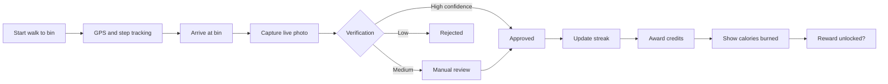
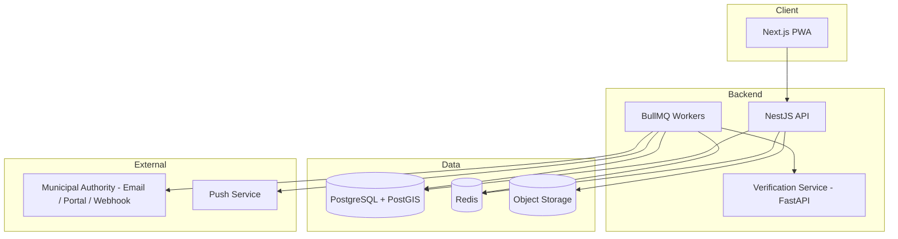

# CleanStreak

> Make proper waste disposal a daily habit. Snap a photo of yourself using the dustbin, grow your streak, earn credits, and unlock rewards.

*CleanStreak is a working name. Rename it freely.*

---

## Table of Contents

1. [Overview](#overview)
2. [Features](#features)
3. [How It Works](#how-it-works)
4. [Streaks, Credits and Rewards](#streaks-credits-and-rewards)
5. [Calorie Estimator](#calorie-estimator)
6. [Reporting Poor Waste Management](#reporting-poor-waste-management)
7. [Waste Management Tips](#waste-management-tips)
8. [Tech Stack](#tech-stack)
9. [Architecture](#architecture)
10. [Project Structure](#project-structure)
11. [Getting Started](#getting-started)
12. [Environment Variables](#environment-variables)
13. [API Overview](#api-overview)
14. [Roadmap](#roadmap)
15. [Privacy and Safety](#privacy-and-safety)
16. [Contributing](#contributing)
17. [License](#license)

---

## Overview

Littering is rarely about a lack of bins. It is about habit. CleanStreak borrows the mechanics that make people return to language and fitness apps (streaks, points, rewards) and applies them to responsible waste disposal.

**The loop:**

1. You throw garbage in a dustbin and take a photo as proof.
2. The app verifies the photo and adds it to your timeline.
3. Consecutive days build a **streak**, and streaks earn **credits**.
4. Credits unlock **rewards**.
5. Along the way the app shows the **calories you burned** walking to the bin, lets you **report** areas with poor waste management to the authorities, and teaches you **how to manage waste** better.

## Features

### Core

| Feature | Description |
|---|---|
| Photo proof | Capture a live photo of yourself disposing of waste in a bin. Each photo is geotagged and timestamped. |
| Timeline | A calendar and feed of all your verified disposals. |
| Streaks | Dispose of waste properly on consecutive days to grow your streak. Streak freezes protect you on busy days. |
| Credits | Every verified disposal earns credits, with bonuses at streak milestones. |
| Rewards | Redeem credits for coupons, eco-products, tree plantation or donations. Higher tiers unlock better rewards. |

### Additional

| Feature | Description |
|---|---|
| Calorie estimator | Tracks your walk to the bin (distance, time, speed) and estimates calories burned. |
| Report to government | Submit geotagged photo reports (overflowing bins, illegal dumping, missing bins) to the local municipal authority and track the status. |
| Waste tips | A daily tip plus a searchable library on segregation, composting, recycling and e-waste. Tips are personalized to the waste you dispose of. |
| Nearby bins | A map of dustbins near you. |
| Leaderboards | Optional, opt-in neighbourhood and city leaderboards. |

## How It Works



## Streaks, Credits and Rewards

These values are the starting defaults. They live in a config file so you can tune them without code changes.

**Earning credits**

| Action | Credits |
|---|---|
| First verified disposal of the day | 10 (multiplied by the streak multiplier) |
| Extra disposals (up to 2 more per day) | 2 each |
| Accepted waste report | 15 |
| Completing the daily tip quiz | 3 |

**Streak milestones**

| Streak | Bonus credits |
|---|---|
| 3 days | +5 |
| 7 days | +20 |
| 14 days | +40 |
| 30 days | +100 |
| 60 days | +250 |
| 100 days | +500 |

**Streak multiplier:** +10% for every 7 consecutive days, capped at 2x.

**Streak freeze:** Earn one freeze every 10 days (max 2 held). A freeze automatically covers one missed day.

**Reward tiers**

| Tier | Lifetime credits | Example rewards |
|---|---|---|
| Bronze | 0 | Badges, profile frames |
| Silver | 500 | Partner coupons, reusable bag |
| Gold | 1,500 | Eco-products, plant a tree in your name |
| Platinum | 4,000 | Premium partner rewards, community recognition |

Credits are tracked in an append-only ledger. Balances are never edited directly, which keeps the system auditable and hard to abuse.

## Calorie Estimator

Calories burned while walking are estimated with the standard MET formula:

```
calories (kcal) = MET x weight (kg) x duration (hours)
```

MET depends on walking speed (for example, about 3.5 at 4.8 km/h and 4.3 at 5.6 km/h). Weight is optional and set in your profile; a default is used otherwise and the result is labelled as an estimate.

Be realistic about the numbers: a 100 m walk at normal pace burns roughly 5 kcal for a 70 kg person. The value of the feature is the **cumulative** total, shown in your weekly and monthly stats, not any single walk.

## Reporting Poor Waste Management

Users can report:

- Overflowing or damaged bins
- Illegal dumping and garbage heaps
- Open burning of waste
- Missing bins in busy areas
- Lack of segregation at collection points

Each report contains photos, an auto-captured location, a category and an optional description. Nearby duplicate reports are merged so authorities see one issue with many supporters. Reports are forwarded to the municipal authority through a pluggable adapter (email first, official grievance portal APIs where available), and you can follow the status inside the app.

## Waste Management Tips

- **Daily tip** delivered via notification.
- **Library** organized by category: segregation (wet, dry, hazardous), composting, plastic reduction, e-waste, recycling.
- **Personalized** using the waste types detected in your photos. If you mostly dispose of plastic, you see plastic reduction tips.
- **Localized** content, with support for regional languages.

## Tech Stack

| Layer | Choice | Notes |
|---|---|---|
| Frontend | Next.js (React, TypeScript) as a PWA | Camera and geolocation work in the browser. Can be wrapped later with Capacitor or rebuilt in React Native. |
| UI | Tailwind CSS, Leaflet and OpenStreetMap | Free maps, no API key needed. |
| Backend | Node.js with NestJS (TypeScript) | REST API, validation with Zod or class-validator. |
| Database | PostgreSQL with PostGIS | Geospatial queries for bins, reports and duplicate detection. |
| Cache and queues | Redis with BullMQ | Background jobs: verification, notifications, status sync. |
| Storage | S3-compatible (AWS S3, Cloudflare R2 or MinIO locally) | Photos via signed URLs. |
| Verification service | Python with FastAPI and a YOLO-based detector | Detects bin, garbage and person. Starts with manual review. |
| Auth | JWT with refresh tokens; OTP or Google sign-in | |
| Notifications | Web Push (PWA) or Firebase Cloud Messaging | |
| DevOps | Docker, GitHub Actions | |

## Architecture



## Project Structure

```
cleanstreak/
├── apps/
│   ├── web/                    # Next.js PWA (user app + /admin)
│   └── api/                    # NestJS API
│       └── src/
│           ├── auth/
│           ├── disposals/
│           ├── streaks/
│           ├── credits/
│           ├── rewards/
│           ├── walks/          # distance and calorie tracking
│           ├── reports/        # government reporting
│           ├── tips/
│           ├── bins/
│           └── notifications/
├── services/
│   └── verification/           # FastAPI image verification
├── packages/
│   └── shared/                 # shared types and config (credit rules, etc.)
├── infra/
│   └── docker-compose.yml      # Postgres, Redis, MinIO
├── README.md
└── implementation.md
```

## Getting Started

**Prerequisites:** Node.js 20+, pnpm, Docker, Python 3.11+

```bash
# 1. Clone
git clone https://github.com/<your-username>/cleanstreak.git
cd cleanstreak

# 2. Start infrastructure (Postgres + PostGIS, Redis, MinIO)
docker compose -f infra/docker-compose.yml up -d

# 3. Install dependencies
pnpm install

# 4. Configure environment
cp .env.example .env

# 5. Run database migrations and seed data (tips, rewards, sample bins)
pnpm --filter api db:migrate
pnpm --filter api db:seed

# 6. Start the apps
pnpm --filter api dev        # http://localhost:4000
pnpm --filter web dev        # http://localhost:3000

# 7. (Optional) Start the verification service
cd services/verification
python -m venv .venv && source .venv/bin/activate
pip install -r requirements.txt
uvicorn main:app --port 8000
```

Camera access requires HTTPS outside of `localhost`. Use a tunnel such as ngrok when testing on your phone.

## Environment Variables

| Variable | Description |
|---|---|
| `DATABASE_URL` | PostgreSQL connection string |
| `REDIS_URL` | Redis connection string |
| `JWT_SECRET` / `JWT_REFRESH_SECRET` | Token signing secrets |
| `S3_ENDPOINT`, `S3_BUCKET`, `S3_ACCESS_KEY`, `S3_SECRET_KEY` | Object storage |
| `VERIFICATION_URL` | URL of the verification service |
| `AUTO_APPROVE_THRESHOLD` | Confidence for auto-approval (default `0.85`) |
| `REVIEW_THRESHOLD` | Confidence below which photos are rejected (default `0.50`) |
| `AUTHORITY_EMAIL_DEFAULT` | Fallback email for waste reports |
| `SMTP_URL` | Outgoing mail for report forwarding |
| `VAPID_PUBLIC_KEY` / `VAPID_PRIVATE_KEY` | Web push keys |

## API Overview

Full request and response details are in [`implementation.md`](./implementation.md).

| Method | Endpoint | Purpose |
|---|---|---|
| POST | `/auth/register`, `/auth/login` | Account management |
| POST | `/walks/start`, `/walks/:id/points`, `/walks/:id/finish` | Track the walk to the bin |
| POST | `/disposals` | Submit a disposal photo |
| GET | `/me/streak` | Current and longest streak |
| GET | `/me/credits` | Balance and ledger |
| GET / POST | `/rewards`, `/rewards/:id/redeem` | Browse and redeem rewards |
| POST / GET | `/reports`, `/reports/:id` | Submit and track waste reports |
| GET | `/tips/daily`, `/tips` | Waste management tips |
| GET | `/bins/nearby` | Nearby dustbins |

## Roadmap

- [ ] **Phase 1 (MVP):** auth, photo capture, manual review, streaks, credits
- [ ] **Phase 2:** automated photo verification, rewards store, tiers
- [ ] **Phase 3:** walk tracking and calorie estimates
- [ ] **Phase 4:** waste reporting with status tracking
- [ ] **Phase 5:** tips engine, notifications, leaderboards, launch
- [ ] **Later:** native apps, partner API for businesses, municipality dashboard, community clean-up events

## Privacy and Safety

- Location is collected only during a walk or when a photo or report is submitted.
- Faces are blurred in any photo shown publicly, and EXIF data is stripped.
- Body measurements (weight, height) are optional and used only for calorie estimates.
- Users can export or delete their data at any time.
- Compliance with applicable data protection laws (such as GDPR or India's DPDP Act) should be reviewed before launch.
- Users are reminded never to enter unsafe areas to take a photo or file a report.

## Contributing

1. Fork the repo and create a branch: `git checkout -b feature/your-feature`
2. Make your changes with tests
3. Run `pnpm lint && pnpm test`
4. Open a pull request describing what and why

## License

MIT. See `LICENSE` for details.
